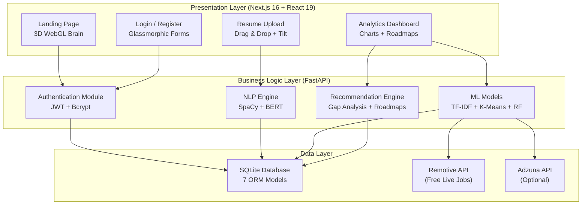

# Chapter 1: Introduction and Problem Statement

---

## 1.1 Introduction

The landscape of employment and career development has undergone a transformative shift in the 21st century, driven predominantly by the rapid advancement of technology, the proliferation of digital platforms, and the emergence of entirely new industries and job roles. The World Economic Forum's "Future of Jobs Report" consistently highlights that technological disruption, including artificial intelligence, robotics, and the Internet of Things, is fundamentally reshaping the global labor market. According to recent estimates, approximately 85 million jobs may be displaced by automation by 2025, while 97 million new roles may emerge that are more adapted to the new division of labor between humans, machines, and algorithms.

In this dynamic environment, individuals face the unprecedented challenge of continuously evaluating their skill sets, identifying gaps in their competencies, and strategically planning their career trajectories. The traditional approach to career guidance — which typically involves manual resume review by human resource professionals, subjective career counseling sessions, and generic job search platforms — is increasingly inadequate for addressing the complexities of the modern job market. These conventional methods suffer from several critical limitations:

1. **Scalability**: Human career counselors cannot process the vast volume of job listings, skill requirements, and individual profiles simultaneously.

2. **Subjectivity**: Traditional career advice is often based on personal experience and opinion rather than data-driven analysis of market trends and skill demand.

3. **Timeliness**: The job market evolves rapidly, and static career guidance cannot keep pace with emerging technologies and shifting industry requirements.

4. **Personalization**: Generic career platforms provide one-size-fits-all recommendations that fail to account for the unique combination of skills, experience, and aspirations of individual users.

5. **Actionability**: Most career platforms identify opportunities but fail to provide concrete, personalized learning pathways to bridge identified skill gaps.

The convergence of Natural Language Processing (NLP), Machine Learning (ML), and modern web development technologies presents a powerful opportunity to address these limitations. NLP enables the automated extraction and understanding of skills and competencies from unstructured resume text. ML algorithms can learn patterns from vast datasets of job requirements to provide intelligent, personalized recommendations. Modern full-stack web frameworks enable the delivery of these intelligent capabilities through responsive, visually rich, and intuitive user interfaces.

The **Smart Career & Resume AI Platform** represents a comprehensive solution that integrates these technologies into a unified, end-to-end career intelligence system. The platform accepts user resumes, automatically extracts skills using advanced NLP techniques, matches these skills against real-time job market data using ML algorithms, identifies skill gaps through mathematical set analysis, and generates personalized, multi-phase learning roadmaps — all delivered through a premium, data-rich dashboard interface.

This project report documents the complete design, development, and implementation of this platform, covering every technical module from database schema design to 3D frontend visualization, providing a thorough academic treatment of the technologies, algorithms, and architectural decisions involved.

---

## 1.2 Motivation

The motivation for developing the Smart Career & Resume AI Platform stems from several converging factors observed in the current employment landscape:

### 1.2.1 The Skills Gap Crisis

The global skills gap is widening at an alarming rate. A study by McKinsey Global Institute found that by 2030, as many as 375 million workers — roughly 14 percent of the global workforce — may need to switch occupational categories as digitization, automation, and advances in artificial intelligence disrupt the world of work. This creates an urgent need for tools that can help individuals identify which skills they need to acquire and provide actionable guidance on how to acquire them.

### 1.2.2 Information Overload in Job Markets

Modern job seekers are confronted with an overwhelming volume of information. Major job platforms such as LinkedIn, Indeed, and Naukri collectively list millions of job postings at any given time, each with varying skill requirements, experience levels, and industry contexts. Without intelligent filtering and matching, individuals struggle to identify the opportunities most relevant to their specific profiles.

### 1.2.3 Inefficiency of Manual Resume Analysis

Traditional resume review processes are inherently slow and subjective. Human recruiters spend an average of 6-7 seconds scanning a resume before making an initial decision. This brief review cannot capture the nuanced skill profile of a candidate. Automated NLP-based resume analysis can extract comprehensive skill profiles with computed confidence scores in seconds, providing a far more thorough assessment.

### 1.2.4 Lack of Personalized Career Intelligence

While numerous career assessment tools exist, most provide generic advice based on broad categories (e.g., "you should consider a career in technology"). Few platforms offer the granular, skill-level analysis needed to create truly personalized career strategies. The Smart Career Platform addresses this by computing exact match percentages against specific roles and generating customized learning paths for each identified skill gap.

### 1.2.5 Academic Integration Opportunity

This project provides an exceptional opportunity to integrate knowledge from multiple academic domains — software engineering, database management, natural language processing, machine learning, web development, and user interface design — into a single cohesive application. The interdisciplinary nature of the project demonstrates the practical application of theoretical concepts learned throughout the computer science curriculum.

### 1.2.6 Open-Source Technology Ecosystem

The maturity and availability of open-source technologies such as SpaCy, HuggingFace Transformers, Scikit-Learn, FastAPI, and Next.js make it feasible to build a sophisticated AI-powered platform without the need for expensive proprietary tools or large-scale computing infrastructure.

---

## 1.3 Problem Statement

Despite the proliferation of job search platforms and career development tools, there exists a significant gap in the market for a comprehensive, AI-driven solution that integrates the following capabilities within a single platform:

1. **Automated Resume Parsing**: The ability to accept resumes in multiple formats (PDF, TXT) and automatically extract structured skill information from unstructured text using NLP techniques.

2. **Intelligent Skill Extraction**: Moving beyond simple keyword matching to employ Named Entity Recognition (NER), contextual embeddings (BERT), and curated whitelist validation to achieve high-precision skill identification with confidence scoring.

3. **Real-Time Job Matching**: Utilizing TF-IDF vectorization and cosine similarity to compute mathematically precise match scores between user skill profiles and current job market requirements, with integration to live job data APIs.

4. **Quantitative Skill Gap Analysis**: Computing the exact gap between a user's existing skills and the requirements of target career paths, expressed as precise match percentages and prioritized lists of missing skills.

5. **Personalized Learning Roadmap Generation**: Automatically creating structured, multi-phase learning paths that guide users from foundational knowledge to advanced proficiency in each identified missing skill.

6. **Career Path Exploration**: Enabling users to explore and compare multiple career trajectories simultaneously, with skill alignment scoring for each path.

7. **Skill Demand Forecasting**: Providing predictive analytics on future skill demand trends to help users make forward-looking career decisions.

8. **Premium User Experience**: Delivering all these capabilities through a modern, responsive, visually rich web interface that makes complex analytical data intuitive and actionable.

### Formal Problem Statement

> *Given a user's resume document (in PDF or plain text format), design and implement an intelligent, full-stack web platform that: (a) automatically extracts the user's skill profile using NLP techniques including SpaCy NER and BERT embeddings; (b) matches the extracted skills against real-time job market data using TF-IDF cosine similarity; (c) computes quantitative skill gap analyses against multiple career paths; (d) generates personalized, multi-phase learning roadmaps for identified skill gaps; and (e) presents all results through a premium, data-rich dashboard interface with interactive visualizations — enabling data-driven career decision-making.*

The core challenge lies in building an end-to-end pipeline that seamlessly connects document parsing, NLP analysis, ML-based matching, gap computation, recommendation generation, and frontend visualization within a unified, production-ready application architecture.

---

## 1.4 Objectives of the Project

The primary objectives of the Smart Career & Resume AI Platform are as follows:

### Primary Objectives

1. **To design and implement a robust resume parsing engine** capable of extracting raw text from PDF and plain text documents using pdfplumber and PyPDF libraries.

2. **To develop an NLP-powered skill extraction pipeline** that combines SpaCy Named Entity Recognition with a curated Master Skill Whitelist of 80+ technical and non-technical skills, utilizing regex-based pattern matching for high-precision skill detection.

3. **To implement BERT-based contextual embeddings** using the HuggingFace `sentence-transformers/all-MiniLM-L6-v2` model for generating high-dimensional skill vector representations suitable for downstream ML tasks.

4. **To build a TF-IDF and cosine similarity-based job recommendation engine** that computes precise match scores between user skill vectors and job requirement vectors.

5. **To integrate real-time job market data** through the Remotive API (free, no API key required) and the Adzuna API (optional, key-based) with an intelligent multi-tier fallback mechanism.

6. **To implement a mathematical skill gap analysis module** that computes set intersections and differences between user skills and target role requirements, yielding quantitative match percentages.

7. **To develop a personalized learning roadmap generator** that creates multi-phase learning paths (Beginner → Intermediate → Advanced → Capstone) with curated resource links for each identified missing skill.

8. **To implement K-Means clustering** for grouping similar job roles, enabling the identification of alternative career paths.

9. **To develop a Random Forest-based skill demand forecasting module** for predicting future skill demand trends.

10. **To build a modern, responsive frontend** using Next.js 16, React 19, TypeScript, and TailwindCSS 4, featuring 3D WebGL visualizations (Three.js), interactive charts (Chart.js), and smooth animations (Framer Motion).

11. **To implement secure user authentication** using JWT tokens with bcrypt password hashing.

12. **To design and implement a relational database schema** using SQLAlchemy ORM with SQLite for storing user profiles, skills, jobs, courses, roadmaps, and progress tracking data.

### Secondary Objectives

13. **To ensure clean separation of concerns** through modular backend architecture with distinct modules for NLP, ML, API routes, and core infrastructure.

14. **To provide comprehensive API documentation** through FastAPI's auto-generated Swagger/OpenAPI interface.

15. **To create a premium, visually stunning user interface** that communicates complex analytical data in an intuitive, accessible manner.

---

## 1.5 Scope of the Project

### In Scope

The Smart Career & Resume AI Platform encompasses the following features and capabilities:

- Resume upload and parsing (PDF and TXT formats)
- NLP-based skill extraction using SpaCy and BERT
- Whitelist-based skill validation with confidence scoring
- TF-IDF and cosine similarity-based job matching
- Live job data integration via Remotive and Adzuna APIs
- Mathematical skill gap analysis
- Multi-phase personalized learning roadmap generation
- Career path comparison across 8 predefined industry domains
- Interactive analytics dashboard with 4 chart types (Radar, Bar, Line, Doughnut)
- 3D WebGL landing page with animated brain visualization
- JWT-based user authentication with registration and login
- SQLite database with 7 entity models
- Responsive design for desktop and tablet viewports
- Platform link generation for Indeed, LinkedIn, Google Jobs, Naukri, and Glassdoor

### Out of Scope

The following features are explicitly excluded from the current version of the project:

- Real-time chat or messaging between users and career counselors
- Resume generation or formatting tools
- Video interview preparation features
- Social networking capabilities
- Mobile native applications (iOS/Android)
- Multi-language resume support (English only)
- Payment processing or subscription management
- Integration with Learning Management Systems (LMS)

---

## 1.6 Proposed System Framework

The Smart Career & Resume AI Platform is designed as a three-tier web application consisting of a Presentation Layer (frontend), a Business Logic Layer (backend), and a Data Layer (database). The following diagram illustrates the high-level framework of the proposed system:

**Figure 1.3: Proposed System Framework — High-Level Block Diagram**

### 1.6.1 Framework Components

**Presentation Layer**: Built with Next.js 16 and React 19, the frontend layer handles all user interactions, including resume upload, authentication, and dashboard visualization. It communicates with the backend exclusively through RESTful API calls.

**Business Logic Layer**: The FastAPI backend houses all the intelligence of the platform. It is organized into four major modules:
- **Authentication Module**: Handles user registration, login, and JWT token management.
- **NLP Engine**: Processes uploaded resumes to extract skills using SpaCy NER and BERT embeddings.
- **ML Models**: Implements TF-IDF matching, K-Means clustering, and Random Forest forecasting.
- **Recommendation Engine**: Performs skill gap analysis and generates personalized learning roadmaps.

**Data Layer**: The SQLite database stores all persistent data, while external APIs (Remotive and Adzuna) provide real-time job market data.

---

## 1.7 Organization of the Project Report

This project report is organized into fourteen chapters, each addressing a specific aspect of the Smart Career & Resume AI Platform. The organization is as follows:

**Chapter 1 — Introduction and Problem Statement**: Introduces the project, discusses the motivation behind it, formally states the problem, outlines objectives, defines the scope, and presents the proposed system framework.

**Chapter 2 — Literature Review**: Provides a comprehensive survey of existing research and technologies in the areas of resume parsing, NLP-based skill extraction, machine learning for job recommendation, clustering techniques, skill gap analysis, and modern web application architectures. Identifies research gaps addressed by this project.

**Chapter 3 — System Architecture and Design**: Presents the detailed system architecture, including technology stack selection, backend and frontend architectures, database design, API design, authentication architecture, NLP and ML pipeline architectures, data flow diagrams, and deployment architecture.

**Chapter 4 — Core Infrastructure — Database and Models**: Provides an in-depth walkthrough of the database configuration, SQLAlchemy ORM setup, and all seven entity models (User, UserSkill, Job, Course, Roadmap, UserProgress, APICache) with complete code explanations and ER diagrams.

**Chapter 5 — Authentication and Security Module**: Details the JWT-based authentication system, including bcrypt password hashing, token generation and validation, user registration and login endpoints, OAuth2 password bearer flow, and Pydantic schema definitions.

**Chapter 6 — NLP Engine — Resume Processing Pipeline**: Covers the complete NLP pipeline, including PDF and text extraction, SpaCy NER-based entity extraction, the Master Skill Whitelist, regex-based matching, confidence scoring, BERT contextual embeddings, mean pooling, and the master orchestrator function.

**Chapter 7 — Machine Learning Models**: Explains all ML modules, including TF-IDF vectorization, cosine similarity computation, live job data fetching, K-Means clustering, Random Forest demand forecasting, and personalized course recommendation.

**Chapter 8 — API Layer — Routes and Endpoints**: Documents all FastAPI endpoints, including the application setup, CORS configuration, router registration, and detailed walkthroughs of each endpoint's request/response cycle.

**Chapter 9 — Frontend — User Interface Design**: Covers the complete frontend implementation, including the Next.js project structure, global styling, the 3D landing page, login/register page, resume upload page, analytics dashboard, Chart.js visualizations, and the API client library.

**Chapter 10 — Integration, Data Flow, and System Workflow**: Traces the end-to-end data flow through the system, covering user workflows, sequence diagrams, and error handling strategies.

**Chapter 11 — Testing and Validation**: Describes the testing strategy, including unit testing, API testing, NLP validation, ML model assessment, and integration testing.

**Chapter 12 — Deployment and DevOps**: Covers the deployment process for both backend (Render) and frontend (Vercel), environment configuration, and CI/CD pipelines.

**Chapter 13 — Results and Discussion**: Presents the results of NLP extraction, job matching, career path recommendation, user interface evaluation, and performance benchmarks, with comparative analysis against existing systems.

**Chapter 14 — Conclusion and Future Work**: Summarizes the key contributions of the project, discusses limitations, and proposes directions for future enhancement.

**Appendices**: Include complete source code listings, API documentation, database schema diagrams, and a user manual.

---

\newpage

