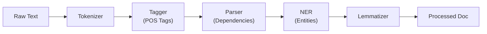
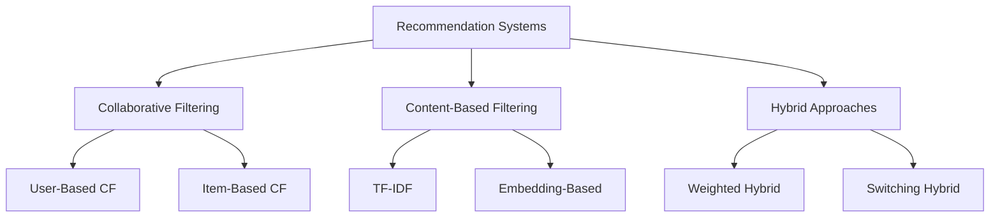
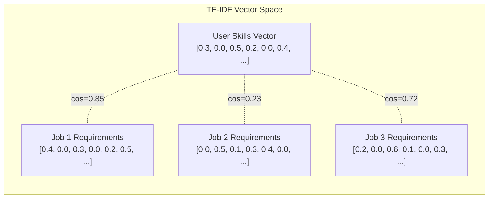
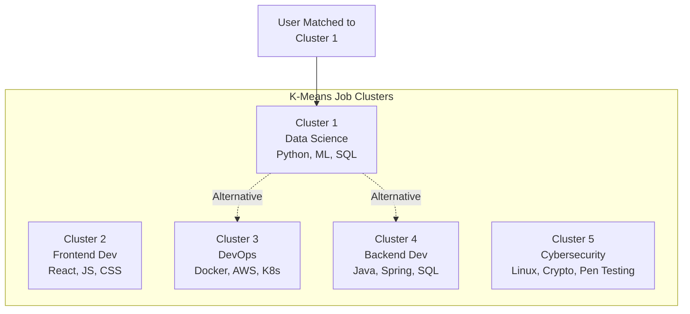
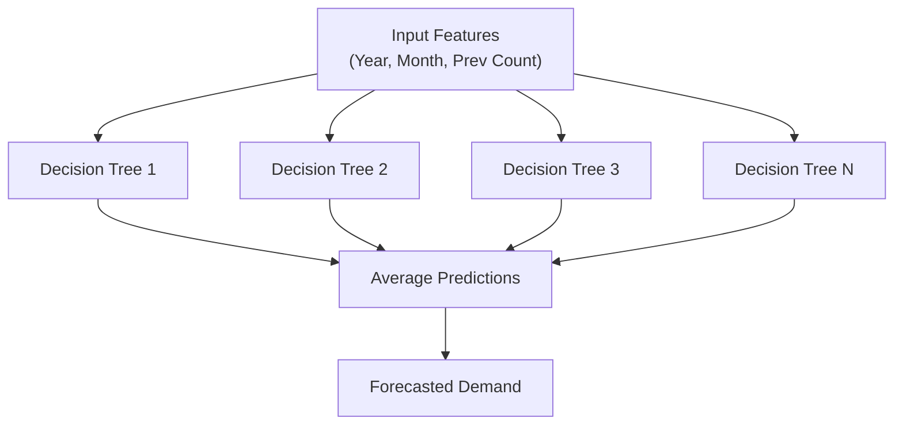

# Chapter 2: Literature Review

---

## 2.1 Introduction

This chapter presents a comprehensive review of existing literature, research, and technologies relevant to the design and development of the Smart Career & Resume AI Platform. The review covers six major domains: resume parsing and information extraction, natural language processing for skill identification, machine learning algorithms for job recommendation, clustering and classification techniques, skill gap analysis methodologies, and modern web application architectures. The chapter concludes with an identification of research gaps that the present project addresses.

A systematic approach was adopted for this literature survey. Research papers were sourced from major academic databases including IEEE Xplore, ACM Digital Library, Springer, ScienceDirect, and Google Scholar. The search was focused on publications from 2018 to 2025 to ensure relevance to current technologies and methodologies. Additionally, technical documentation of open-source libraries (SpaCy, HuggingFace, Scikit-Learn, FastAPI, Next.js) was extensively reviewed to inform implementation decisions.

---

## 2.2 Resume Parsing and Information Extraction

### 2.2.1 Overview of Resume Parsing

Resume parsing, also referred to as CV parsing or resume extraction, is the process of automatically converting unstructured or semi-structured resume data into a structured format suitable for computational analysis. The challenge of resume parsing stems from the inherent variability in resume formats, layouts, writing styles, and the use of domain-specific terminology across different industries.

Kopparapu (2010) identified three primary approaches to resume parsing:

1. **Rule-Based Parsing**: Uses predefined patterns, regular expressions, and heuristics to identify resume sections and extract information. While computationally efficient, this approach is brittle and fails when confronted with non-standard resume formats.

2. **Statistical Parsing**: Employs probabilistic models such as Hidden Markov Models (HMM) and Conditional Random Fields (CRF) to learn the structure of resumes from annotated training data. This approach is more robust but requires large volumes of manually annotated training data.

3. **Deep Learning-Based Parsing**: Uses neural networks, including Recurrent Neural Networks (RNN), Long Short-Term Memory (LSTM) networks, and Transformer models to understand resume content at a semantic level. This approach achieves the highest accuracy but demands significant computational resources.

### 2.2.2 PDF Text Extraction Technologies

The extraction of text from PDF documents presents unique technical challenges due to the PDF format's design as a presentation-oriented rather than content-oriented format. PDF files store text as positioned character sequences without inherent semantic structure, making text extraction non-trivial.

Several Python libraries have been developed to address this challenge:

**PyPDF (formerly PyPDF2)**: An open-source Python library for reading and manipulating PDF files. It provides basic text extraction capabilities by iterating through PDF page objects. While reliable for simple text-heavy PDFs, it may struggle with complex layouts, tables, and multi-column formats (Fenniak, 2023).

**pdfplumber**: Built on top of the pdfminer library, pdfplumber provides more sophisticated text extraction with better handling of table structures and spatial layouts. It preserves the positional information of text elements, enabling more accurate extraction from formatted documents (Singer-Vine, 2020).

**Apache Tika**: A content analysis toolkit that supports text extraction from over 1,500 file formats, including PDF, Word, and HTML. While powerful, it introduces a Java dependency that adds complexity to Python-based applications (Apache Foundation, 2023).

The Smart Career Platform employs a **dual-engine extraction strategy**, attempting pdfplumber first for its superior layout handling and falling back to PyPDF when pdfplumber fails, ensuring robust extraction across diverse resume formats.

### 2.2.3 Text Preprocessing Techniques

Following text extraction, several preprocessing steps are typically applied to normalize and clean the raw text:

- **Tokenization**: Breaking text into individual words or tokens
- **Lemmatization**: Reducing words to their base or dictionary form
- **Stop Word Removal**: Eliminating common words (e.g., "the," "is," "at") that carry little semantic meaning
- **Case Normalization**: Converting all text to lowercase for consistent matching
- **Whitespace Normalization**: Removing excess whitespace, newlines, and special characters

SpaCy, the NLP library used in this project, provides built-in pipeline components for all these preprocessing tasks, making it an efficient choice for resume text preprocessing (Honnibal & Montani, 2017).

---

## 2.3 Natural Language Processing for Skill Extraction

### 2.3.1 Named Entity Recognition (NER)

Named Entity Recognition is a fundamental NLP task that involves identifying and classifying named entities in text into predefined categories such as person names, organizations, locations, products, and more. NER is critical for resume analysis because skills, technologies, and competencies often appear as recognizable entities within resume text.

SpaCy's NER implementation uses a transition-based neural network model trained on annotated corpora. The `en_core_web_md` model used in this project provides entity recognition for multiple categories, including:

| Entity Label | Description | Relevance to Skills |
|---|---|---|
| ORG | Organizations | Company names, technology vendors |
| PRODUCT | Products | Software tools, frameworks |
| WORK_OF_ART | Creative works | Projects, publications |
| GPE | Geopolitical entities | Location-based skills |
| PERSON | Person names | Not directly relevant |

**Table 2.1: SpaCy NER Entity Categories Relevant to Skill Extraction**

However, standard NER models are not specifically trained for skill extraction, which presents a limitation. Technical skills such as "Python," "machine learning," or "Docker" may be classified as ORG, PRODUCT, or even missed entirely by generic NER models. This limitation motivates the use of supplementary extraction strategies, such as the whitelist-based approach employed in this project.

### 2.3.2 SpaCy NLP Pipeline

SpaCy implements a modular processing pipeline that applies multiple NLP operations sequentially:

**Figure 2.2: SpaCy NLP Processing Pipeline**

Each component in the pipeline enriches the document with linguistic annotations that can be leveraged for skill extraction:

- **Tokenizer**: Splits text into tokens using language-specific rules
- **Tagger**: Assigns Part-of-Speech (POS) tags (noun, verb, adjective, etc.)
- **Parser**: Analyzes syntactic dependencies between tokens
- **NER**: Identifies and classifies named entities
- **Lemmatizer**: Reduces tokens to their base forms

The `en_core_web_md` model (medium English model) provides a balance between accuracy and speed, with word vectors (300-dimensional GloVe vectors) that enable semantic similarity computations.

### 2.3.3 Transformer Models and BERT

Bidirectional Encoder Representations from Transformers (BERT), introduced by Devlin et al. (2019), represents a paradigm shift in NLP. Unlike previous unidirectional language models, BERT processes text bidirectionally, capturing context from both left and right surrounding words simultaneously.

The key innovations of BERT include:

1. **Bidirectional Context**: BERT reads entire sequences of text at once, understanding the full context of each word.

2. **Pre-training Tasks**: BERT is pre-trained on two tasks — Masked Language Modeling (MLM) and Next Sentence Prediction (NSP) — on large text corpora.

3. **Transfer Learning**: Pre-trained BERT models can be fine-tuned for specific downstream tasks with relatively small amounts of task-specific data.

4. **Contextual Embeddings**: Unlike static word embeddings (e.g., Word2Vec, GloVe), BERT generates context-dependent embeddings where the same word can have different vector representations depending on its surrounding context.

### 2.3.4 Sentence Transformers

The `sentence-transformers` library (Reimers & Gurevych, 2019) extends BERT for generating semantically meaningful sentence and text embeddings. The `all-MiniLM-L6-v2` model used in this project is a lightweight sentence transformer with the following specifications:

| Specification | Value |
|---|---|
| Base Model | MiniLM |
| Layers | 6 |
| Hidden Size | 384 |
| Parameters | ~22 million |
| Embedding Dimension | 384 |
| Max Sequence Length | 256 tokens |
| Speed | ~14,200 sentences/sec (CPU) |

**Table 2.4: BERT Model Specifications — all-MiniLM-L6-v2**

This model strikes an optimal balance between computational efficiency and embedding quality, making it suitable for real-time skill embedding generation in a web application context.

### 2.3.5 Whitelist-Based Skill Matching

While NER and contextual embeddings provide powerful extraction capabilities, they can generate false positives (extracting non-skill entities) and false negatives (missing valid skills). A complementary approach is whitelist-based matching, where extracted text is compared against a curated dictionary of known skills.

This approach offers several advantages:
- **High precision**: Only known valid skills are extracted
- **Domain specificity**: The whitelist can be customized for specific industries
- **Interpretability**: Results are easily understood and validated
- **Speed**: Simple string matching is computationally inexpensive

The trade-off is that whitelist-based approaches cannot discover new or emerging skills not yet included in the dictionary. The Smart Career Platform addresses this by maintaining a comprehensive whitelist of 80+ skills covering both technical and non-technical domains.

---

## 2.4 Machine Learning for Job Recommendation

### 2.4.1 Recommendation System Approaches

Recommendation systems are broadly classified into three categories:

**Figure 2.3: Classification of Recommendation System Approaches**

**Collaborative Filtering (CF)**: Makes predictions about a user's interests based on the preferences of similar users. CF can be user-based (finding users with similar preferences) or item-based (finding items similar to those the user has liked). The primary limitation of CF is the cold-start problem — it requires historical interaction data, which is unavailable for new users (Koren et al., 2009).

**Content-Based Filtering (CBF)**: Recommends items based on a comparison of item attributes with user preferences. In the job recommendation context, this involves comparing job skill requirements with user skill profiles. CBF does not suffer from the cold-start problem for items (as recommendations are based on item attributes rather than user interactions) but requires effective feature representation (Pazzani & Billsus, 2007).

**Hybrid Approaches**: Combine collaborative and content-based methods to leverage the strengths of both. Examples include weighted hybrids, switching hybrids, and cascading hybrids (Burke, 2002).

The Smart Career Platform employs a **content-based filtering approach** using TF-IDF vectorization and cosine similarity, which is well-suited for the job recommendation domain because:
1. Job requirements and user skills are naturally represented as text features
2. The system can provide meaningful recommendations for new users (no cold-start problem)
3. Recommendations are transparent and interpretable

### 2.4.2 TF-IDF (Term Frequency — Inverse Document Frequency)

TF-IDF is a numerical statistic that reflects the importance of a word in a document relative to a collection of documents (corpus). Introduced by Sparck Jones (1972) and refined by Salton & Buckley (1988), TF-IDF remains one of the most widely used text representation methods for information retrieval and text mining.

The TF-IDF score is computed as:

**TF-IDF(t, d, D) = TF(t, d) × IDF(t, D)**

Where:
- **TF(t, d)** = (Number of times term t appears in document d) / (Total number of terms in document d)
- **IDF(t, D)** = log(Total number of documents in corpus D / Number of documents containing term t)

The TF component measures the local importance of a term within a document, while the IDF component measures the global importance of a term across the entire corpus. Terms that appear frequently in a specific document but rarely across the corpus receive high TF-IDF scores, indicating their discriminative power.

In the context of job recommendation:
- Each job's required skills are treated as a "document"
- The user's skill set is treated as the query "document"
- TF-IDF vectorization converts these text representations into numerical vectors
- Cosine similarity between vectors measures the alignment between user skills and job requirements

### 2.4.3 Cosine Similarity

Cosine similarity measures the cosine of the angle between two non-zero vectors in a multi-dimensional space. It is defined as:

**cos(θ) = (A · B) / (||A|| × ||B||)**

Where A and B are the TF-IDF vectors of the user skills and job requirements, respectively.

Key properties of cosine similarity:
- Range: [-1, 1] for general vectors; [0, 1] for TF-IDF vectors (non-negative)
- Value of 1 indicates identical orientation (perfect match)
- Value of 0 indicates orthogonality (no match)
- Length-independent: normalizes for document length differences

Cosine similarity is preferred over Euclidean distance for text similarity because it is insensitive to document length — a critical property when comparing skill sets of varying sizes (Huang, 2008).

### 2.4.4 Related Work in Job Recommendation Systems

Several notable research works have addressed the job recommendation problem:

| Authors | Year | Approach | Key Contribution |
|---|---|---|---|
| Al-Otaibi & Ykhlef | 2012 | Hybrid CF + CBF | Combined collaborative and content-based approaches for job recommendation |
| Dave et al. | 2018 | Deep Learning | Used LSTM networks for job-resume matching |
| Qin et al. | 2018 | Reinforcement Learning | Applied RL for personalized job recommendation sequences |
| Zhu et al. | 2018 | CNN | Used convolutional neural networks for person-job fit |
| Luo et al. | 2019 | BERT + Attention | Applied BERT with attention mechanisms for resume-job matching |
| Gugnani & Misra | 2020 | Graph Neural Networks | Modeled skills as a graph for better relationship capture |
| Jiang et al. | 2020 | Knowledge Graph | Used knowledge graphs for career path recommendation |

**Table 2.2: Machine Learning Approaches in Job Recommendation Literature**

---

## 2.5 Content-Based Filtering and TF-IDF

### 2.5.1 Scikit-Learn Implementation

Scikit-Learn (Pedregosa et al., 2011) provides a robust and well-documented implementation of TF-IDF through the `TfidfVectorizer` class. This implementation includes several optimizations:

- **Sublinear TF scaling**: Applies logarithmic scaling to term frequency (1 + log(tf))
- **L2 normalization**: Normalizes output vectors to unit length
- **Stop word removal**: Built-in English stop word list
- **N-gram support**: Can consider multi-word phrases (bigrams, trigrams)
- **Max/Min document frequency**: Filters terms that are too common or too rare

The `TfidfVectorizer` in Scikit-Learn follows a two-step process:
1. **fit()**: Learns the vocabulary and IDF values from the corpus
2. **transform()**: Converts new documents into TF-IDF vector representations

This fit-transform pattern is used in the Smart Career Platform to vectorize both user skills and job requirements into a common vector space, enabling cosine similarity computation.

### 2.5.2 Vector Space Model

The Vector Space Model (VSM) represents documents and queries as vectors in a high-dimensional space where each dimension corresponds to a term in the vocabulary. In the job recommendation context:

**Figure 2.4: TF-IDF Vector Space Model — Job Matching**

In this model, the user's skill set and each job's requirements are represented as sparse vectors. The cosine similarity between the user vector and each job vector determines the recommendation ranking.

---

## 2.6 Clustering Techniques for Career Grouping

### 2.6.1 K-Means Clustering

K-Means clustering (MacQueen, 1967) is an unsupervised learning algorithm that partitions n observations into k clusters, where each observation belongs to the cluster with the nearest mean (centroid). The algorithm iteratively:

1. **Initializes** k centroids randomly (or using k-means++ initialization)
2. **Assigns** each data point to the nearest centroid
3. **Updates** each centroid to the mean of its assigned points
4. **Repeats** steps 2-3 until convergence (centroids no longer change significantly)

The objective function minimized by K-Means is:

**J = Σ Σ ||x - μ_k||²**

Where μ_k is the centroid of cluster k and x is a data point assigned to cluster k.

### 2.6.2 Application to Job Grouping

In the career recommendation context, K-Means clustering is applied to group similar job roles based on their skill requirement profiles. The process involves:

1. **Feature Extraction**: Converting job titles and required skills into TF-IDF vectors
2. **Clustering**: Applying K-Means to partition jobs into k groups
3. **Career Path Identification**: Interpreting each cluster as a distinct career pathway
4. **Alternative Career Discovery**: For a user's primary job cluster, identifying nearby clusters as alternative career paths

**Figure 2.5: K-Means Clustering for Job Grouping**

### 2.6.3 Limitations and Considerations

K-Means has several known limitations:
- Requires specifying the number of clusters k in advance
- Sensitive to initial centroid placement
- Assumes spherical cluster shapes
- Sensitive to outliers
- May converge to local optima

The Elbow Method and Silhouette Analysis are commonly used to determine the optimal value of k. In the Smart Career Platform, k is set to 5 as a default, representing five broad career categories. The n_init parameter is set to 10, running the algorithm 10 times with different centroid seeds and selecting the best result to mitigate the initialization sensitivity.

---

## 2.7 Skill Gap Analysis and Learning Path Generation

### 2.7.1 Mathematical Framework for Skill Gap Analysis

Skill gap analysis can be formalized using set theory. Given:
- **U** = Set of user's skills (extracted from resume)
- **J** = Set of required skills for a target job/role

The following metrics are computed:

- **Matched Skills**: U ∩ J (intersection of user skills and job requirements)
- **Missing Skills**: J \ U (skills required by the job but not possessed by the user)
- **Extra Skills**: U \ J (skills possessed by the user but not required by the job)
- **Match Percentage**: |U ∩ J| / |J| × 100

This mathematical framework provides a clear, quantitative assessment of how well a user's skills align with a target role, and precisely identifies which skills need to be acquired.

### 2.7.2 Learning Path Generation Strategies

Several approaches exist for generating personalized learning paths:

1. **Difficulty-Based Sequencing**: Arranging learning resources from beginner to advanced levels
2. **Prerequisite-Based Sequencing**: Ordering topics based on dependency relationships
3. **Competency-Based Sequencing**: Adapting the path based on demonstrated competency at each stage
4. **Time-Based Sequencing**: Estimating the time required for each learning phase

The Smart Career Platform employs a **difficulty-based sequencing** approach with four distinct phases:

| Phase | Level | Content Type | Description |
|---|---|---|---|
| 1 | Beginner | Topic | Core concepts and fundamentals |
| 2 | Intermediate | Lab | Applied knowledge and best practices |
| 3 | Advanced | Project | Hands-on mini-project implementation |
| 4 | Expert | Domain Project | Capstone project integrating all skills |

**Table 2.6: Multi-Phase Learning Path Structure**

---

## 2.8 Time-Series Forecasting for Skill Demand

### 2.8.1 Random Forest for Regression

Random Forest (Breiman, 2001) is an ensemble learning method that constructs multiple decision trees during training and outputs the average prediction of individual trees for regression tasks. Key characteristics include:

- **Bagging**: Each tree is trained on a random bootstrap sample of the training data
- **Feature Randomness**: At each split, only a random subset of features is considered
- **Ensemble Averaging**: The final prediction is the mean of all individual tree predictions

**Figure 2.6: Random Forest Ensemble Architecture for Demand Prediction**

Random Forest is chosen for skill demand forecasting because:
- It handles non-linear relationships well
- It is robust to overfitting due to ensemble averaging
- It requires minimal hyperparameter tuning
- It can capture complex interactions between temporal features

### 2.8.2 Application to Skill Demand Prediction

In the Smart Career Platform, the Random Forest model is trained on historical job posting data with features including year, month, and previous month's posting count. The model predicts future posting counts, which serve as a proxy for skill demand. The forecasted trends help users prioritize learning skills that are projected to grow in demand.

---

## 2.9 Modern Web Application Architectures

### 2.9.1 FastAPI Framework

FastAPI (Ramírez, 2018) is a modern, high-performance Python web framework for building APIs. Key features include:

- **Speed**: Comparable to Node.js and Go, based on Starlette and Pydantic
- **Type Safety**: Uses Python type hints for automatic request validation
- **Auto Documentation**: Generates Swagger UI and ReDoc documentation automatically
- **Async Support**: Native support for asynchronous request handling
- **Dependency Injection**: Built-in dependency injection system for database sessions, authentication, etc.

### 2.9.2 Next.js Framework

Next.js (Vercel, 2016) is a React-based framework for building full-stack web applications. Version 16, used in this project, introduces:

- **App Router**: File-system based routing with layouts and nested routes
- **Server Components**: React Server Components for improved performance
- **Server Actions**: Server-side mutations without API routes
- **Streaming**: Progressive rendering with Suspense boundaries
- **Turbopack**: Next-generation bundler for faster development builds

### 2.9.3 Three-Tier Architecture Pattern

The three-tier architecture pattern separates an application into three logical layers:

1. **Presentation Tier**: User interface (Next.js frontend)
2. **Logic Tier**: Business logic and processing (FastAPI backend)
3. **Data Tier**: Database and data storage (SQLite)

This separation provides modularity, maintainability, and the ability to independently scale or replace each tier.

---

## 2.10 Comparative Analysis of Existing Systems

| Feature | LinkedIn | Indeed | Naukri | Our Platform |
|---|---|---|---|---|
| Resume Parsing | ✓ | ✗ | ✓ | ✓ |
| NLP Skill Extraction | ✓ (Proprietary) | ✗ | ✗ | ✓ (SpaCy + BERT) |
| Skill Gap Analysis | ✗ | ✗ | ✗ | ✓ |
| Learning Roadmaps | ✓ (LinkedIn Learning) | ✗ | ✗ | ✓ |
| Job Matching with ML | ✓ (Proprietary) | Basic keyword | Basic keyword | ✓ (TF-IDF + Cosine) |
| Demand Forecasting | ✗ | ✗ | ✗ | ✓ |
| Career Path Comparison | ✗ | ✗ | ✗ | ✓ |
| Open Source | ✗ | ✗ | ✗ | ✓ |
| 3D Visualization | ✗ | ✗ | ✗ | ✓ |
| Multi-Platform Links | ✗ | ✗ | ✗ | ✓ |

**Table 2.3: Feature Comparison — Existing Systems vs. Smart Career Platform**

---

## 2.11 Research Gaps Identified

Based on the comprehensive literature review, the following research gaps have been identified that the Smart Career Platform addresses:

1. **Integrated Pipeline Gap**: Most existing systems address individual aspects (resume parsing OR job matching OR learning recommendation) but do not integrate these into a seamless end-to-end pipeline.

2. **Quantitative Gap Analysis**: Few platforms provide precise, mathematical skill gap analysis with exact match percentages and prioritized missing skill lists.

3. **Multi-Path Career Comparison**: Existing platforms typically recommend a single career direction. The Smart Career Platform enables simultaneous comparison across 8 predefined career paths.

4. **Real-Time Data Integration**: Many research prototypes use static datasets. This platform integrates live job data from real APIs (Remotive, Adzuna) with intelligent fallback mechanisms.

5. **Transparency and Interpretability**: Proprietary platforms (LinkedIn, Indeed) use opaque matching algorithms. This platform provides transparent, interpretable matching based on established ML techniques.

6. **Personalized Learning Paths**: While some platforms recommend courses, few generate structured, multi-phase learning paths customized to each user's specific skill gaps.

7. **Open-Source Alternative**: There is a lack of open-source, full-stack career intelligence platforms that can be freely deployed and customized.

---

## 2.12 Summary

This chapter provided a comprehensive review of the literature and technologies relevant to the Smart Career & Resume AI Platform. The review covered resume parsing techniques, NLP methods for skill extraction (SpaCy NER, BERT embeddings, whitelist matching), machine learning approaches for job recommendation (TF-IDF, cosine similarity, K-Means clustering, Random Forest regression), skill gap analysis methodologies, learning path generation strategies, and modern web application architectures (FastAPI, Next.js). A comparative analysis with existing commercial platforms and the identification of seven key research gaps demonstrated the novelty and value of the proposed system. The subsequent chapters detail the design, implementation, and evaluation of the platform that addresses these identified gaps.

---

\newpage

