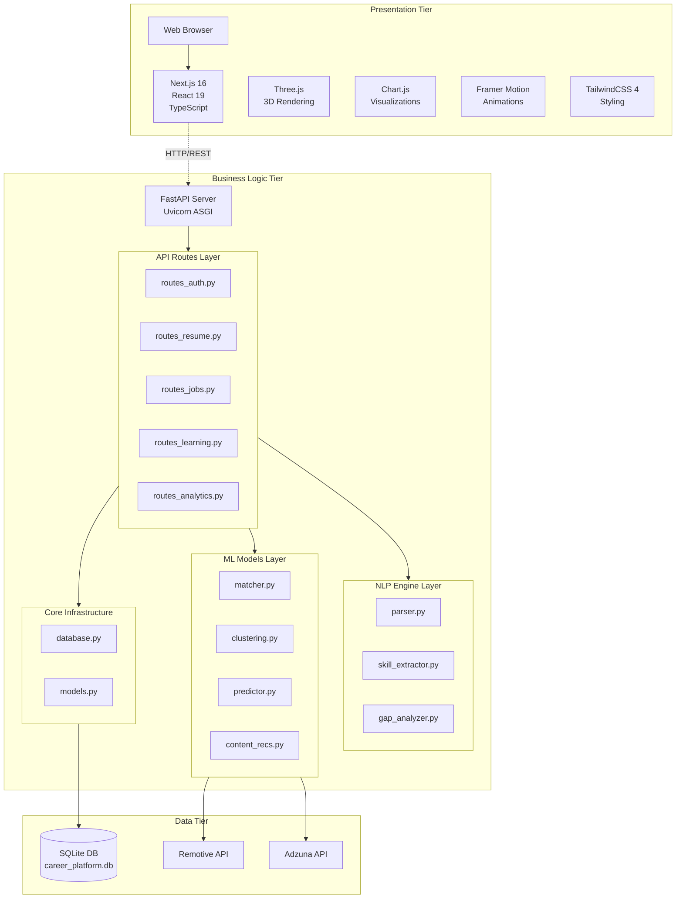
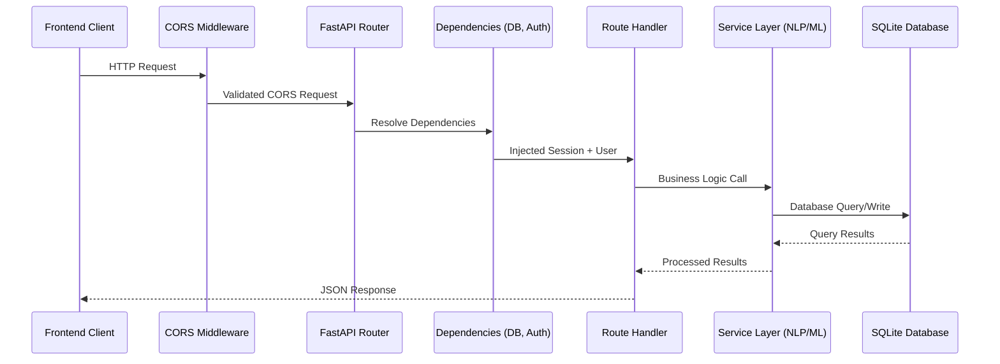
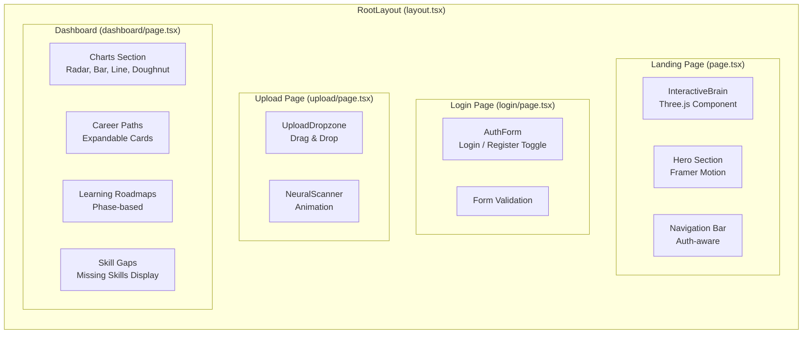
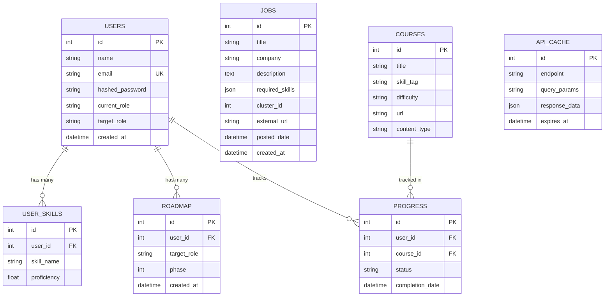
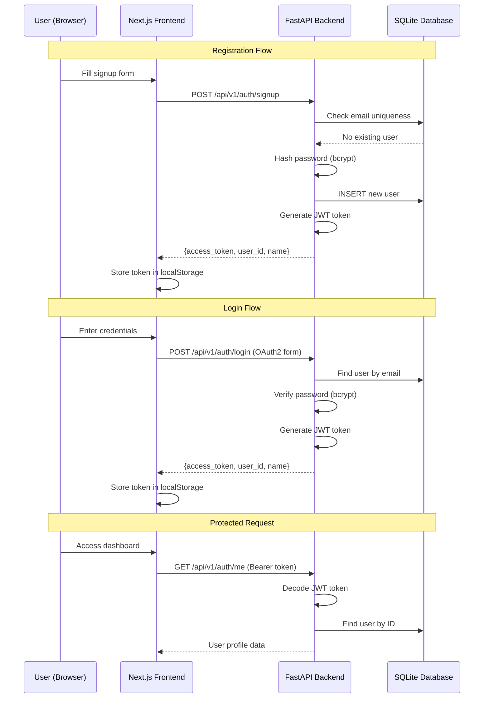
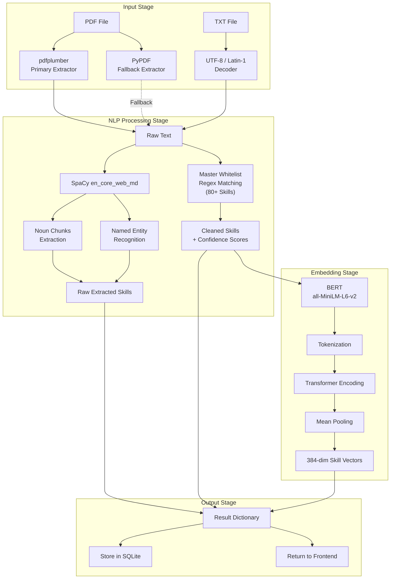
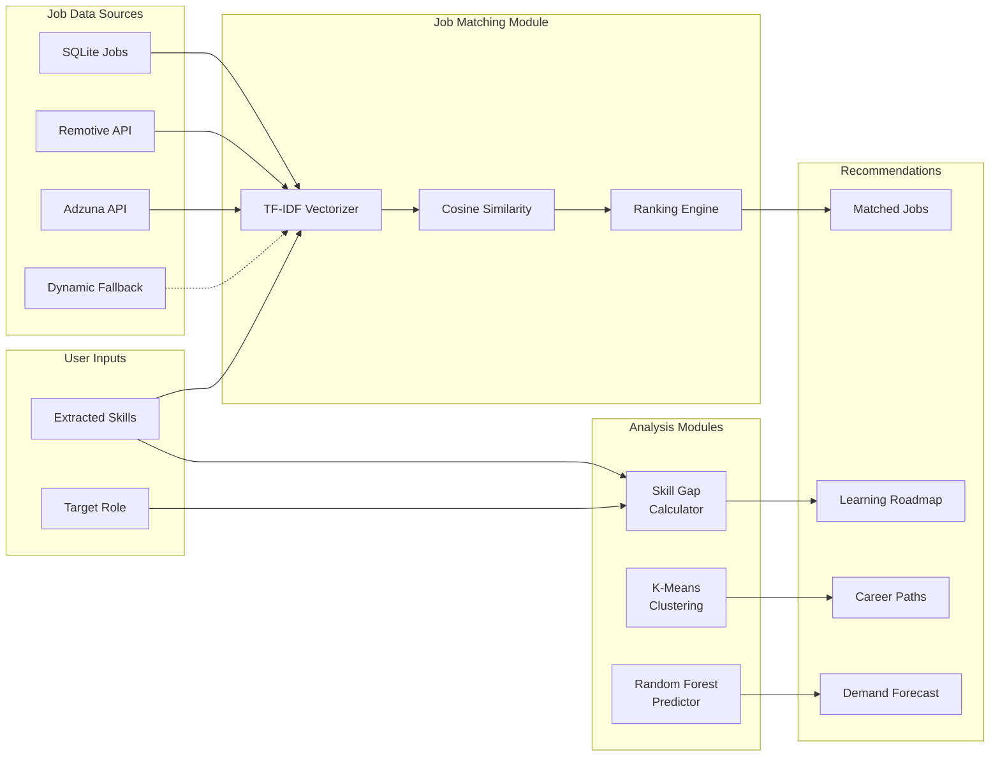
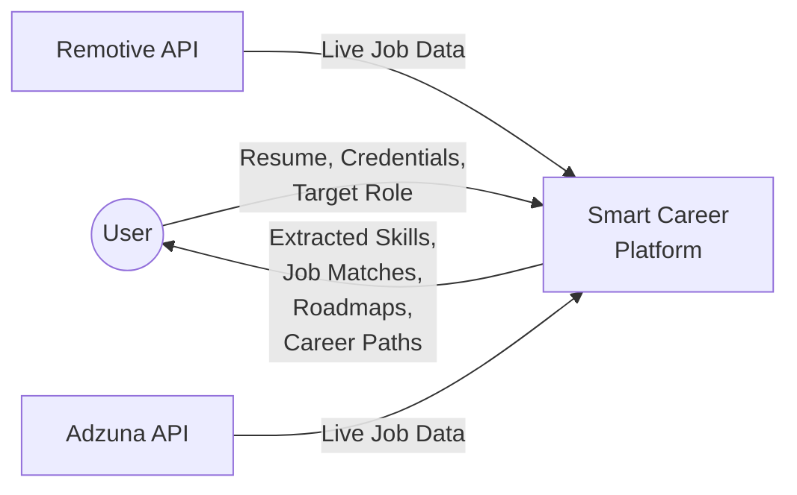
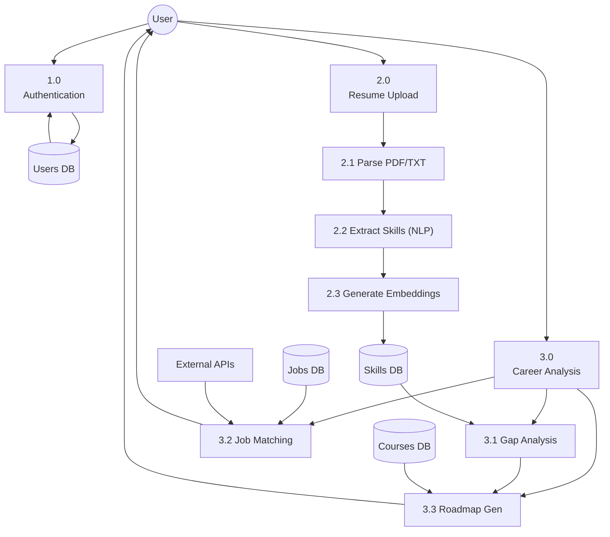
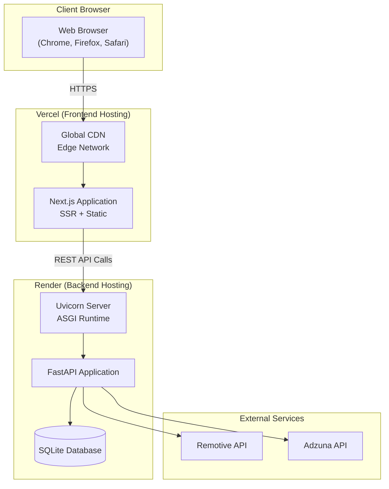

# Chapter 3: System Architecture and Design

---

## 3.1 Introduction

This chapter presents the comprehensive system architecture and design of the Smart Career & Resume AI Platform. A well-thought-out architecture is the foundation of any robust software system, ensuring modularity, scalability, maintainability, and performance. The chapter covers the high-level system architecture, technology stack selection rationale, backend and frontend architectures, database design, API design conventions, authentication architecture, NLP and ML pipeline architectures, data flow diagrams, and deployment architecture.

The system is designed following the **three-tier architecture pattern**, which separates the application into three distinct logical layers: Presentation (Frontend), Business Logic (Backend), and Data (Database + External APIs). This separation ensures that each layer can be developed, tested, deployed, and scaled independently.

---

## 3.2 High-Level System Architecture

The Smart Career Platform architecture comprises three primary tiers connected through RESTful API communication:



**Figure 3.1: High-Level System Architecture Diagram**

### 3.2.1 Architecture Principles

The following design principles guided the architecture:

1. **Separation of Concerns**: Each module has a single, well-defined responsibility. The NLP engine handles text processing, the ML layer handles predictions, the API layer handles HTTP communication, and the frontend handles user interaction.

2. **Loose Coupling**: Modules interact through well-defined interfaces (function calls and API endpoints), minimizing dependencies between components.

3. **High Cohesion**: Related functionality is grouped together within the same module (e.g., all authentication logic in `routes_auth.py`).

4. **Statelessness**: The backend API is stateless — each request contains all information needed for processing (via JWT tokens). This simplifies scaling and deployment.

5. **Progressive Enhancement**: The system degrades gracefully when external services are unavailable (e.g., the job API fallback mechanism).

---

## 3.3 Technology Stack Selection

### 3.3.1 Backend Technology Stack

| Technology | Version | Purpose | Selection Rationale |
|---|---|---|---|
| **Python** | 3.10+ | Core language | Rich ML/NLP ecosystem, widely used in data science |
| **FastAPI** | 0.104.1 | Web framework | High performance, type safety, auto docs, async support |
| **Uvicorn** | 0.24.0 | ASGI server | Production-grade ASGI server for FastAPI |
| **SQLAlchemy** | 2.0.23 | ORM | Industry-standard Python ORM, database-agnostic |
| **Pydantic** | 2.4.2 | Data validation | Automatic request/response validation via type hints |
| **SpaCy** | Latest | NLP processing | Fast, industrial-strength NLP, pre-trained models |
| **Transformers** | Latest | BERT embeddings | HuggingFace ecosystem, extensive pre-trained models |
| **PyTorch** | Latest | ML framework | Required by HuggingFace Transformers |
| **Scikit-Learn** | Latest | ML algorithms | TF-IDF, K-Means, Random Forest implementations |
| **Pandas** | Latest | Data manipulation | DataFrame operations for ML pipelines |
| **NumPy** | Latest | Numerical computing | Array operations, mathematical functions |
| **pdfplumber** | Latest | PDF extraction | Superior table and layout handling |
| **PyPDF** | Latest | PDF extraction | Fallback PDF text extraction |
| **python-jose** | Latest | JWT tokens | JWT encoding/decoding with cryptographic support |
| **passlib+bcrypt** | Latest | Password hashing | Secure password hashing with salt |

**Table 3.1: Backend Technology Stack**

### 3.3.2 Frontend Technology Stack

| Technology | Version | Purpose | Selection Rationale |
|---|---|---|---|
| **Next.js** | 16.2.1 | React framework | SSR, file-based routing, optimized builds |
| **React** | 19.2.4 | UI library | Component-based architecture, virtual DOM |
| **TypeScript** | 5.x | Language | Type safety, better IDE support, fewer runtime errors |
| **TailwindCSS** | 4.x | Styling | Utility-first CSS, rapid prototyping, consistent design |
| **Three.js** | 0.183.2 | 3D rendering | WebGL-based 3D visualization |
| **React Three Fiber** | 9.6.0 | React + Three.js | Declarative Three.js with React component model |
| **Drei** | 10.7.7 | Three.js helpers | Pre-built 3D components (Stars, Float, Sphere) |
| **Chart.js** | 4.5.1 | Charts | Responsive, animated chart library |
| **react-chartjs-2** | 5.3.1 | React + Chart.js | React wrapper for Chart.js |
| **Framer Motion** | 12.38.0 | Animations | Declarative animation library for React |
| **Lucide React** | 1.7.0 | Icons | Modern, customizable icon library |
| **react-tilt** | 1.0.2 | Tilt effects | 3D parallax tilt effect for cards |

**Table 3.2: Frontend Technology Stack**

---

## 3.4 Backend Architecture (FastAPI)

### 3.4.1 Module Organization

The backend follows a modular architecture organized into four major directories:

```
backend/
├── main.py                  # Application entry point
├── requirements.txt         # Python dependencies
├── test_auth.py            # Authentication tests
├── api/                    # API Route Handlers
│   ├── routes_auth.py      # Authentication endpoints
│   ├── routes_resume.py    # Resume processing endpoint
│   ├── routes_jobs.py      # Job recommendation endpoint
│   ├── routes_learning.py  # Roadmap & career path endpoints
│   └── routes_analytics.py # Skill demand forecast endpoint
├── core/                   # Core Infrastructure
│   ├── database.py         # Database engine & session setup
│   └── models.py           # SQLAlchemy ORM models
├── nlp_engine/             # NLP Processing Modules
│   ├── parser.py           # PDF/TXT text extraction
│   ├── skill_extractor.py  # SpaCy + BERT skill extraction
│   └── gap_analyzer.py     # Skill gap computation
└── ML_models/              # Machine Learning Modules
    ├── matcher.py          # TF-IDF job matching + live API
    ├── clustering.py       # K-Means job clustering
    ├── predictor.py        # Random Forest demand prediction
    └── content_recs.py     # Learning path recommendation
```

**Figure 3.4: FastAPI Backend Module Organization**

### 3.4.2 Application Initialization

The FastAPI application is initialized in `main.py`, which serves as the entry point for the entire backend. The initialization process involves:

1. **Creating the FastAPI instance** with metadata (title, description, version)
2. **Configuring CORS middleware** to allow cross-origin requests from the frontend
3. **Registering startup events** for database initialization
4. **Including API routers** with URL prefixes

```python
# main.py - Application Entry Point
from fastapi import FastAPI
from fastapi.middleware.cors import CORSMiddleware
from backend.core.database import init_db
from backend.api import routes_resume, routes_jobs, routes_learning, 
                        routes_analytics, routes_auth

app = FastAPI(
    title="Smart Career & Resume AI Platform",
    description="Backend API powering the Resume NLP and Job ML Models.",
    version="1.0.0"
)

# CORS Configuration for Frontend Communication
app.add_middleware(
    CORSMiddleware,
    allow_origins=["*"], 
    allow_credentials=True,
    allow_methods=["*"],
    allow_headers=["*"],
)

# Database Initialization on Startup
@app.on_event("startup")
def on_startup():
    init_db()

# Router Registration with API Versioning
app.include_router(routes_auth.router, prefix="/api/v1")
app.include_router(routes_resume.router, prefix="/api/v1")
app.include_router(routes_jobs.router, prefix="/api/v1")
app.include_router(routes_learning.router, prefix="/api/v1")
app.include_router(routes_analytics.router, prefix="/api/v1")

# Health Check Endpoint
@app.get("/")
def check_health():
    return {"status": "operational", "message": "ML Engine Online"}
```

### 3.4.3 Request Processing Pipeline

Every incoming HTTP request passes through the following processing pipeline:



**Figure 3.4.3: Request Processing Pipeline — Sequence Diagram**

---

## 3.5 Frontend Architecture (Next.js)

### 3.5.1 Next.js App Router Structure

The frontend uses Next.js 16's App Router, which employs a file-system based routing convention:

```
frontend/src/
├── app/                          # App Router Root
│   ├── layout.tsx               # Root layout (HTML, head, body)
│   ├── page.tsx                 # Landing page (/)
│   ├── globals.css              # Global styles + design tokens
│   ├── favicon.ico              # Site favicon
│   ├── login/
│   │   └── page.tsx             # Login/Register page (/login)
│   ├── upload/
│   │   └── page.tsx             # Resume upload page (/upload)
│   └── dashboard/
│       └── page.tsx             # Analytics dashboard (/dashboard)
├── components/                   # Reusable Components
│   ├── AnalyticsCharts.tsx      # Chart components
│   ├── AuthNavigation.tsx       # Auth-aware navigation
│   ├── JobCard.tsx              # Job listing card
│   ├── RoadmapTimeline.tsx      # Learning timeline
│   ├── Sidebar.tsx              # Navigation sidebar
│   └── UploadDropzone.tsx       # File upload zone
└── lib/
    └── api.ts                   # API client wrapper
```

**Figure 3.5: Next.js Frontend Application Structure**

### 3.5.2 Component Architecture

The frontend follows a component-based architecture where each page is composed of reusable, self-contained components:



**Figure 3.5.2: Frontend Component Hierarchy**

### 3.5.3 State Management

The frontend uses React's built-in state management through:

- **`useState`**: Local component state for UI interactions (form inputs, toggles, loading states)
- **`useEffect`**: Side effects for data fetching and localStorage access
- **`localStorage`**: Client-side persistence for authentication tokens, user data, and extracted skills

No external state management library (Redux, Zustand) is used, as the application's state complexity is manageable with React's built-in hooks.

---

## 3.6 Database Design

### 3.6.1 Entity-Relationship Diagram



**Figure 3.6: Entity-Relationship Diagram — Complete Database Schema**

### 3.6.2 Database Design Decisions

1. **SQLite Selection**: Chosen for development simplicity, zero-configuration deployment, and serverless operation. The single-file database format simplifies local development and testing. For production scaling, migration to PostgreSQL is straightforward via SQLAlchemy's database-agnostic ORM.

2. **JSON Columns**: The `required_skills` field in the `jobs` table uses a JSON column type to store variable-length skill lists without requiring a separate junction table.

3. **Soft Relationships**: While `courses` has no direct foreign key relationship with `roadmap`, they are connected semantically through `skill_tag` matching during roadmap generation.

4. **Caching Layer**: The `api_cache` table provides a simple time-based caching mechanism for external API responses, reducing API call frequency and improving response times.

---

## 3.7 API Design and RESTful Conventions

### 3.7.1 Endpoint Summary

| Method | Endpoint | Auth | Description |
|---|---|---|---|
| `GET` | `/` | No | Health check |
| `POST` | `/api/v1/auth/signup` | No | User registration |
| `POST` | `/api/v1/auth/login` | No | User authentication |
| `GET` | `/api/v1/auth/me` | JWT | Get current user profile |
| `POST` | `/api/v1/upload-resume/` | No* | Upload and parse resume |
| `GET` | `/api/v1/recommend-jobs/{user_id}` | No* | Get job recommendations |
| `GET` | `/api/v1/roadmap/{user_id}/{job_id}` | No* | Generate learning roadmap |
| `POST` | `/api/v1/roadmap/live-pivot` | JWT | Live career pivot analysis |
| `POST` | `/api/v1/roadmap/analyze-career-paths` | No* | Multi-path career analysis |
| `GET` | `/api/v1/skill-demand/{skill_name}` | No | Skill demand forecast |

**Table 3.3: RESTful API Endpoints Summary**

*\*These endpoints accept auth headers but do not strictly require them for backward compatibility.*

### 3.7.2 API Versioning

All API endpoints are prefixed with `/api/v1/` to support future versioning. When breaking changes are introduced, a new version (`/api/v2/`) can be deployed alongside the existing version, allowing gradual migration.

### 3.7.3 Response Format

All API responses follow a consistent JSON format:

```json
// Success Response
{
    "message": "Operation completed successfully",
    "data": { ... },
    "count": 10
}

// Error Response (handled by FastAPI HTTPException)
{
    "detail": "Error description message"
}
```

---

## 3.8 Authentication Architecture



**Figure 3.8: JWT Authentication Flow — Complete Sequence Diagram**

---

## 3.9 NLP Pipeline Architecture



**Figure 3.9: NLP Processing Pipeline Architecture**

---

## 3.10 ML Pipeline Architecture



**Figure 3.10: ML Model Integration Architecture**

---

## 3.11 Data Flow Diagrams

### 3.11.1 Level 0 — Context Diagram



**Figure 3.11: Data Flow Diagram — Level 0 (Context Diagram)**

### 3.11.2 Level 1 — Detailed Data Flow



**Figure 3.12: Data Flow Diagram — Level 1**

---

## 3.12 Deployment Architecture



**Figure 3.13: Deployment Architecture Diagram**

---

## 3.13 Summary

This chapter presented the comprehensive system architecture and design of the Smart Career & Resume AI Platform. The three-tier architecture separates concerns into a Next.js 16 frontend, a FastAPI backend, and a SQLite data layer. The backend is organized into four modular directories (api, core, nlp_engine, ML_models) with 12 Python files implementing 8 API endpoints. The frontend consists of 4 pages and 6 reusable components. The database schema comprises 7 entity models with well-defined relationships. The NLP pipeline combines SpaCy NER, whitelist matching, and BERT embeddings for robust skill extraction. The ML pipeline integrates TF-IDF matching, K-Means clustering, and Random Forest prediction. Authentication uses JWT tokens with bcrypt hashing. The subsequent chapters provide detailed implementations of each module.

---

\newpage

