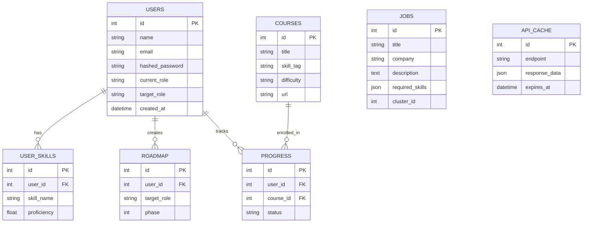

# Chapter 4: Core Infrastructure — Database and Models

---

## 4.1 Introduction

The core infrastructure layer forms the foundation of the Smart Career & Resume AI Platform, providing the essential data persistence and object-relational mapping capabilities that all other modules depend upon. This chapter provides a detailed examination of the database configuration, SQLAlchemy ORM setup, and all seven entity models that define the data structure of the application.

The core infrastructure is implemented in two files within the `backend/core/` directory:
- **`database.py`**: Configures the database engine, session factory, and provides utility functions for database initialization and session management.
- **`models.py`**: Defines all SQLAlchemy ORM models that map Python classes to database tables.

---

## 4.2 Database Configuration (database.py)

### 4.2.1 Complete Source Code

```python
from sqlalchemy import create_engine
from sqlalchemy.orm import sessionmaker
from backend.core.models import Base

# Using SQLite for fast local prototyping (Module 11)
DATABASE_URL = "sqlite:///./career_platform.db"

# Create the SQLAlchemy Engine
engine = create_engine(
    DATABASE_URL, connect_args={"check_same_thread": False}
)

# Create SessionLocal class, instance of which will be a DB session
SessionLocal = sessionmaker(autocommit=False, autoflush=False, bind=engine)

def init_db():
    """ Creates all tables defined in models.py (if they don't exist) """
    Base.metadata.create_all(bind=engine)

def get_db():
    """ Dependency for FastAPI to get a DB session per request """
    db = SessionLocal()
    try:
        yield db
    finally:
        db.close()
```

### 4.2.2 Line-by-Line Explanation

**Lines 1-3 — Imports:**
```python
from sqlalchemy import create_engine
from sqlalchemy.orm import sessionmaker
from backend.core.models import Base
```

- `create_engine`: Factory function that creates a new `Engine` instance, which is the central source of connections to a database.
- `sessionmaker`: Factory class that generates new `Session` objects when called. Sessions represent the "workspace" for ORM operations.
- `Base`: The declarative base class from which all ORM models inherit. Importing it here ensures all model metadata is available for table creation.

**Line 6 — Database URL:**
```python
DATABASE_URL = "sqlite:///./career_platform.db"
```

This defines the connection string for SQLite. The format `sqlite:///./filename.db` specifies:
- `sqlite://` — the database dialect (SQLite)
- `/./` — relative path to the database file
- `career_platform.db` — the database filename

The database file is created in the working directory when the application starts.

**Lines 9-11 — Engine Creation:**
```python
engine = create_engine(
    DATABASE_URL, connect_args={"check_same_thread": False}
)
```

The `check_same_thread=False` argument is specific to SQLite. By default, SQLite only allows access from the thread that created the connection. Since FastAPI uses multiple threads to handle concurrent requests, this flag must be disabled to allow cross-thread access. In production with PostgreSQL, this parameter would not be needed.

**Line 14 — Session Factory:**
```python
SessionLocal = sessionmaker(autocommit=False, autoflush=False, bind=engine)
```

The `sessionmaker` creates a configured session class. Key parameters:
- `autocommit=False`: Transactions are not automatically committed; explicit `db.commit()` calls are required
- `autoflush=False`: Changes are not automatically flushed to the database before queries; explicit flush is needed
- `bind=engine`: Associates sessions with our database engine

**Lines 16-18 — Database Initialization:**
```python
def init_db():
    """ Creates all tables defined in models.py (if they don't exist) """
    Base.metadata.create_all(bind=engine)
```

This function creates all database tables based on the ORM model definitions. `Base.metadata` contains the schema information for all models that inherit from `Base`. The `create_all()` method issues `CREATE TABLE IF NOT EXISTS` statements for each model, ensuring tables are created on first startup without affecting existing data.

**Lines 20-26 — Session Dependency:**
```python
def get_db():
    """ Dependency for FastAPI to get a DB session per request """
    db = SessionLocal()
    try:
        yield db
    finally:
        db.close()
```

This is a **generator function** designed for use as a FastAPI dependency. The pattern ensures proper resource management:

1. A new database session (`db`) is created when a request arrives
2. The session is `yield`ed to the route handler function
3. After the handler completes (or raises an exception), the `finally` block ensures the session is properly closed
4. This prevents database connection leaks


**Figure 4.4: Session Lifecycle — Request/Response Pattern**

---

## 4.3 SQLAlchemy ORM Setup

### 4.3.1 Declarative Base

All ORM models in the application inherit from a common `Base` class created using SQLAlchemy's declarative system:

```python
from sqlalchemy.orm import declarative_base
Base = declarative_base()
```

The `declarative_base()` function creates a base class that:
- Maintains a catalog of all model classes and their table mappings
- Provides the `metadata` object used for schema creation
- Enables the relationship mapping system

### 4.3.2 Common Column Types

The following SQLAlchemy column types are used throughout the models:

| Column Type | Python Type | SQLite Type | Usage |
|---|---|---|---|
| `Integer` | `int` | `INTEGER` | Primary keys, foreign keys |
| `String(n)` | `str` | `VARCHAR(n)` | Names, emails, roles |
| `Float` | `float` | `REAL` | Proficiency scores |
| `Text` | `str` | `TEXT` | Long text content |
| `JSON` | `dict/list` | `TEXT` (serialized) | Skill lists |
| `DateTime` | `datetime` | `TIMESTAMP` | Timestamps |

---

## 4.4 User Model

### 4.4.1 Model Definition

```python
class User(Base):
    __tablename__ = 'users'
    id = Column(Integer, primary_key=True, index=True)
    name = Column(String(100), nullable=False)
    email = Column(String(100), unique=True, index=True, nullable=False)
    hashed_password = Column(String(255), nullable=False)
    current_role = Column(String(100))
    target_role = Column(String(100))  # Career Shift Supported
    created_at = Column(DateTime, default=datetime.utcnow)
    
    # Relationships
    skills = relationship("UserSkill", back_populates="user", 
                          cascade="all, delete-orphan")
    progress = relationship("UserProgress", back_populates="user", 
                           cascade="all, delete-orphan")
    roadmaps = relationship("Roadmap", back_populates="user", 
                           cascade="all, delete-orphan")
```

### 4.4.2 Column Specifications

| Column | Type | Constraints | Description |
|---|---|---|---|
| `id` | Integer | PK, Indexed | Auto-incrementing unique identifier |
| `name` | String(100) | NOT NULL | User's full name |
| `email` | String(100) | UNIQUE, NOT NULL, Indexed | User's email (used for login) |
| `hashed_password` | String(255) | NOT NULL | Bcrypt-hashed password |
| `current_role` | String(100) | Nullable | User's current job title |
| `target_role` | String(100) | Nullable | Desired career direction |
| `created_at` | DateTime | Default: now | Account creation timestamp |

**Table 4.1: User Table — Column Definitions**

### 4.4.3 Relationships

The User model defines three **one-to-many** relationships:

1. **skills**: A user can have multiple extracted skills (`UserSkill` records)
2. **progress**: A user can track multiple course completions (`UserProgress` records)
3. **roadmaps**: A user can have multiple career roadmaps (`Roadmap` records)

The `cascade="all, delete-orphan"` parameter ensures that:
- When a user is deleted, all associated skills, progress records, and roadmaps are also deleted
- Orphaned child records (not linked to any parent) are automatically removed

### 4.4.4 Design Rationale

The `email` field is marked as `unique` and `index=True` because it serves as the primary lookup field during authentication. Indexing ensures O(log n) lookup time rather than O(n) full table scan. The password is stored as a bcrypt hash (never in plain text) in the `hashed_password` field.

> **\[SCREENSHOT PLACEHOLDER: Database table view showing user records in a SQLite browser tool\]**

---

## 4.5 UserSkill Model

### 4.5.1 Model Definition

```python
class UserSkill(Base):
    """ Captured from NLP Engine processing User Resume (Module 2) """
    __tablename__ = 'user_skills'
    id = Column(Integer, primary_key=True, index=True)
    user_id = Column(Integer, ForeignKey('users.id'), nullable=False)
    skill_name = Column(String(100), nullable=False)
    proficiency = Column(Float, default=0.0) 
    
    user = relationship("User", back_populates="skills")
```

### 4.5.2 Column Specifications

| Column | Type | Constraints | Description |
|---|---|---|---|
| `id` | Integer | PK, Indexed | Auto-incrementing unique identifier |
| `user_id` | Integer | FK → users.id, NOT NULL | Reference to the owning user |
| `skill_name` | String(100) | NOT NULL | Name of the extracted skill |
| `proficiency` | Float | Default: 0.0 | NLP-computed confidence score (0.0 - 1.0) |

**Table 4.2: UserSkill Table — Column Definitions**

### 4.5.3 Foreign Key Relationship

The `ForeignKey('users.id')` constraint creates a referential integrity link between the `user_skills` table and the `users` table. This ensures that:
- Every skill record must reference a valid user
- Attempting to insert a skill for a non-existent user will raise an `IntegrityError`
- The database maintains consistency even if application-level checks fail

### 4.5.4 Proficiency Scoring

The `proficiency` field stores a normalized confidence score (0.0 to 1.0) computed by the NLP engine's whitelist matching algorithm. The raw score (0-100) from the skill extractor is divided by 100 before storage:

```python
true_score = skill_scores.get(s, 80) / 100.0
```

---

## 4.6 Job Model

### 4.6.1 Model Definition

```python
class Job(Base):
    """ Live jobs recommended via TF-IDF (Module 4) & Clustered (Module 7) """
    __tablename__ = 'jobs'
    id = Column(Integer, primary_key=True, index=True)
    title = Column(String(150), nullable=False)
    company = Column(String(150))
    description = Column(Text)
    required_skills = Column(JSON) 
    cluster_id = Column(Integer)   
    external_url = Column(String(255))
    posted_date = Column(DateTime)
    created_at = Column(DateTime, default=datetime.utcnow)
```

### 4.6.2 Column Specifications

| Column | Type | Constraints | Description |
|---|---|---|---|
| `id` | Integer | PK, Indexed | Auto-incrementing unique identifier |
| `title` | String(150) | NOT NULL | Job title (e.g., "Data Scientist") |
| `company` | String(150) | Nullable | Company name |
| `description` | Text | Nullable | Full job description text |
| `required_skills` | JSON | Nullable | List of required skills as JSON array |
| `cluster_id` | Integer | Nullable | K-Means cluster assignment |
| `external_url` | String(255) | Nullable | Link to external job posting |
| `posted_date` | DateTime | Nullable | When the job was posted |
| `created_at` | DateTime | Default: now | Record creation timestamp |

**Table 4.3: Job Table — Column Definitions**

### 4.6.3 JSON Column for Skills

The `required_skills` column uses SQLAlchemy's `JSON` type to store skill requirements as a JSON array. In SQLite, this is stored as serialized text and automatically parsed by SQLAlchemy. Example stored value:

```json
["python", "machine learning", "sql", "docker", "aws"]
```

This design choice avoids the need for a separate `job_skills` junction table, simplifying queries while maintaining flexibility for variable-length skill lists.

---

## 4.7 Course Model

### 4.7.1 Model Definition

```python
class Course(Base):
    """ Learning content repository for Gap Analysis (Module 9) """
    __tablename__ = 'courses'
    id = Column(Integer, primary_key=True, index=True)
    title = Column(String(150), nullable=False)
    skill_tag = Column(String(100), nullable=False) 
    difficulty = Column(String(50))   # Foundation, Core, Advanced
    url = Column(String(255))         
    content_type = Column(String(50)) # Video, Article, Project
```

### 4.7.2 Column Specifications

| Column | Type | Constraints | Description |
|---|---|---|---|
| `id` | Integer | PK, Indexed | Auto-incrementing unique identifier |
| `title` | String(150) | NOT NULL | Course title |
| `skill_tag` | String(100) | NOT NULL | Skill this course teaches |
| `difficulty` | String(50) | Nullable | Foundation / Core / Advanced |
| `url` | String(255) | Nullable | Link to course content |
| `content_type` | String(50) | Nullable | Video / Article / Project |

**Table 4.4: Course Table — Column Definitions**

---

## 4.8 Roadmap Model

### 4.8.1 Model Definition

```python
class Roadmap(Base):
    """ AI Generated Sequential Learning Map (Module 5) """
    __tablename__ = 'roadmap'
    id = Column(Integer, primary_key=True, index=True)
    user_id = Column(Integer, ForeignKey('users.id'), nullable=False)
    target_role = Column(String(100), nullable=False)
    phase = Column(Integer, default=1)  # 1, 2, 3 (Foundation, Core, etc.)
    created_at = Column(DateTime, default=datetime.utcnow)

    user = relationship("User", back_populates="roadmaps")
```

### 4.8.2 Column Specifications

| Column | Type | Constraints | Description |
|---|---|---|---|
| `id` | Integer | PK, Indexed | Auto-incrementing unique identifier |
| `user_id` | Integer | FK → users.id, NOT NULL | Reference to the user |
| `target_role` | String(100) | NOT NULL | Target career path |
| `phase` | Integer | Default: 1 | Learning phase (1=Foundation, 2=Core, 3=Advanced) |
| `created_at` | DateTime | Default: now | Roadmap creation timestamp |

**Table 4.5: Roadmap Table — Column Definitions**

---

## 4.9 UserProgress Model

### 4.9.1 Model Definition

```python
class UserProgress(Base):
    """ Tracking user course completion (Module 10) """
    __tablename__ = 'progress'
    id = Column(Integer, primary_key=True, index=True)
    user_id = Column(Integer, ForeignKey('users.id'), nullable=False)
    course_id = Column(Integer, ForeignKey('courses.id'), nullable=False)
    status = Column(String(50), default="Enrolled") 
    completion_date = Column(DateTime, nullable=True)

    user = relationship("User", back_populates="progress")
    course = relationship("Course")
```

### 4.9.2 Column Specifications

| Column | Type | Constraints | Description |
|---|---|---|---|
| `id` | Integer | PK, Indexed | Auto-incrementing unique identifier |
| `user_id` | Integer | FK → users.id, NOT NULL | Reference to the user |
| `course_id` | Integer | FK → courses.id, NOT NULL | Reference to the course |
| `status` | String(50) | Default: "Enrolled" | Enrolled / In Progress / Completed |
| `completion_date` | DateTime | Nullable | When the course was completed |

**Table 4.6: UserProgress Table — Column Definitions**

---

## 4.10 APICache Model

### 4.10.1 Model Definition

```python
class APICache(Base):
    """ External Live Job API request cache (Module 11) """
    __tablename__ = 'api_cache'
    id = Column(Integer, primary_key=True, index=True)
    endpoint = Column(String(255), nullable=False, index=True)
    query_params = Column(String(255))
    response_data = Column(JSON, nullable=False)
    expires_at = Column(DateTime, nullable=False)
```

### 4.10.2 Column Specifications

| Column | Type | Constraints | Description |
|---|---|---|---|
| `id` | Integer | PK, Indexed | Auto-incrementing unique identifier |
| `endpoint` | String(255) | NOT NULL, Indexed | API endpoint URL |
| `query_params` | String(255) | Nullable | Query parameters used |
| `response_data` | JSON | NOT NULL | Cached API response |
| `expires_at` | DateTime | NOT NULL | Cache expiration time |

**Table 4.7: APICache Table — Column Definitions**

---

## 4.11 Entity-Relationship Diagram

The complete entity-relationship diagram showing all seven models and their relationships:



**Figure 4.3: Complete Entity-Relationship Diagram**

---

## 4.12 Database Session Management

### 4.12.1 Dependency Injection Pattern

FastAPI's dependency injection system is used to provide database sessions to route handlers:

```python
# In route handler
@router.post("/signup", response_model=Token)
def create_user(user: UserCreate, db: Session = Depends(get_db)):
    # 'db' is automatically provided and managed
    db_user = db.query(User).filter(User.email == user.email).first()
    ...
```

The `Depends(get_db)` declaration tells FastAPI to:
1. Call the `get_db()` generator before the handler executes
2. Pass the yielded session as the `db` parameter
3. Continue the generator (closing the session) after the handler completes

### 4.12.2 Transaction Management

The session's transaction lifecycle follows this pattern:

```python
# Successful transaction
db.add(new_user)      # Stage a new record
db.commit()           # Persist to database
db.refresh(new_user)  # Reload with DB-generated values (e.g., id)

# Error handling (implicit)
# If an exception occurs, the session is closed without commit,
# effectively rolling back any staged changes
```

---

## 4.13 Summary

This chapter provided a comprehensive examination of the Smart Career Platform's core infrastructure. The database configuration in `database.py` establishes the SQLite connection, engine, session factory, and provides dependency injection support for FastAPI. The seven ORM models defined in `models.py` — User, UserSkill, Job, Course, Roadmap, UserProgress, and APICache — comprehensively model the domain entities needed for career intelligence operations. The entity-relationship diagram illustrates the foreign key relationships between users, skills, roadmaps, and progress tracking. The session management pattern ensures proper resource handling through FastAPI's dependency injection system. This infrastructure layer provides the data foundation upon which all subsequent modules (authentication, NLP, ML, and API routes) are built.

---

\newpage

