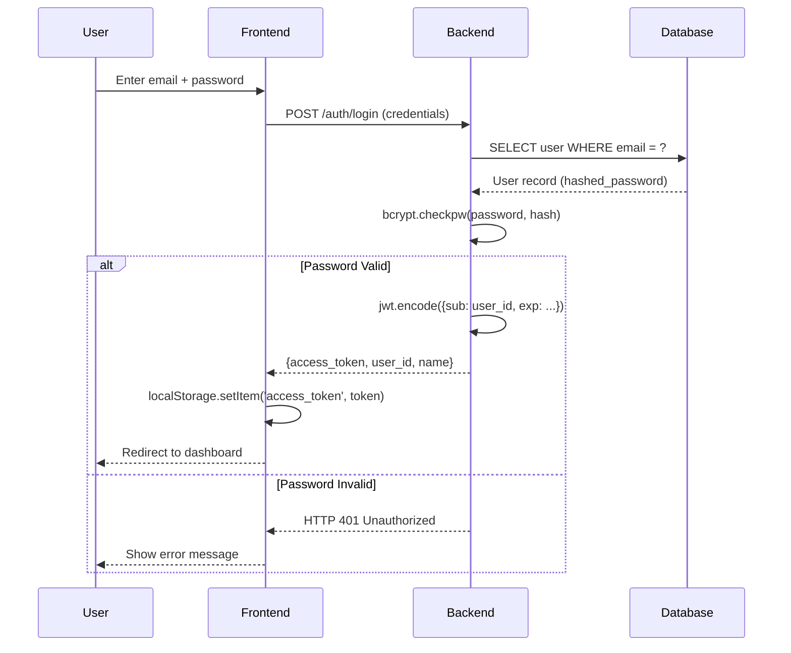
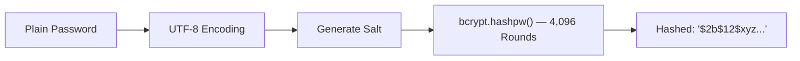
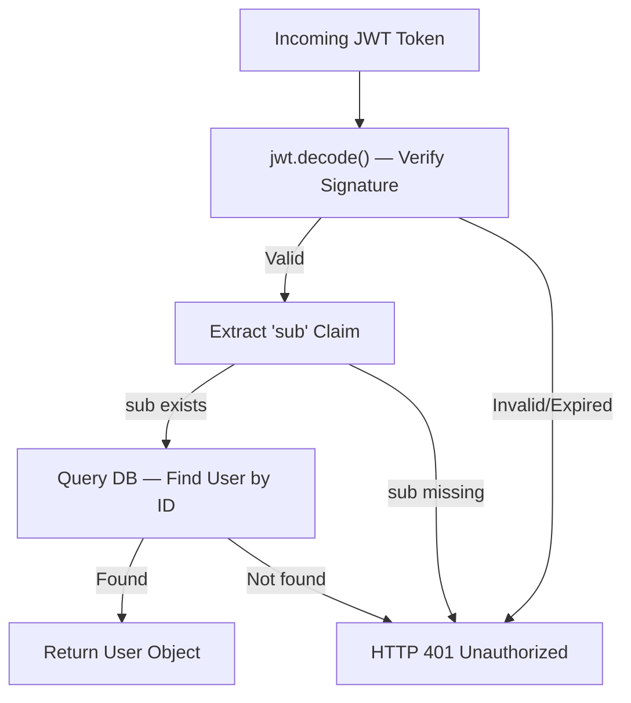
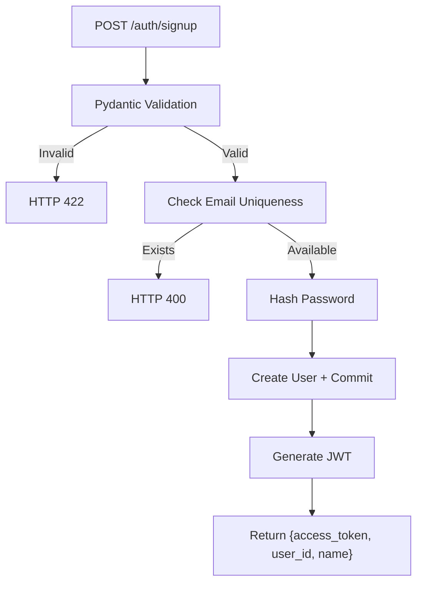

# Chapter 5: Authentication and Security Module

---

## 5.1 Introduction

The Smart Career Platform implements authentication using **JSON Web Tokens (JWT)** with **bcrypt password hashing**, following the **OAuth2 Password Bearer** flow. The module is in `backend/api/routes_auth.py`.

**Figure 5.1: JWT Authentication Sequence Diagram**

---

## 5.2 Security Configuration

The security configuration defines three critical constants that govern token signing and expiration. The `SECRET_KEY` is the cryptographic key used to sign JWT tokens — in production, this must be stored in environment variables rather than hardcoded. The `HS256` algorithm provides HMAC-SHA256 symmetric signing. Tokens are configured for 7-day validity (10,080 minutes) for development convenience.

| Constant | Value | Purpose |
|---|---|---|
| `SECRET_KEY` | Hardcoded string | JWT signing key (must use env var in production) |
| `ALGORITHM` | HS256 | HMAC-SHA256 symmetric signing |
| `ACCESS_TOKEN_EXPIRE_MINUTES` | 10,080 | Token validity: 7 days |

The `OAuth2PasswordBearer` scheme integrates with FastAPI's Swagger UI documentation, extracts Bearer tokens from request headers, and returns HTTP 401 if no valid token is present.

---

## 5.3 Password Hashing with Bcrypt

Bcrypt is a password hashing algorithm specifically designed for secure credential storage. The platform uses it for all password operations through two functions: `get_password_hash()` and `verify_password()`.

**Key characteristics of bcrypt:**

1. **Automatic Salting**: Each password is hashed with a unique, randomly generated salt, preventing rainbow table attacks — even identical passwords produce different hash values.

2. **Configurable Cost Factor**: The default cost factor of 12 means 2^12 = 4,096 iterations of the hashing algorithm, making brute-force attacks computationally expensive.

3. **Embedded Salt Format**: The salt is stored within the hash string itself (`$2b$12$<salt><hash>`), eliminating the need for a separate salt column in the database.

4. **Constant-Time Comparison**: `bcrypt.checkpw()` uses constant-time comparison to prevent timing attacks, where an attacker could measure response times to determine how many characters of a password are correct.

The verification function wraps the bcrypt check in a try/except block, returning `False` for any corrupted or malformed hash rather than crashing the application.

**Figure 5.2: Bcrypt Hashing Process**

---

## 5.4 JWT Token Generation and Validation

### 5.4.1 Token Structure

A JWT token consists of three Base64-encoded parts separated by dots: **Header** (algorithm metadata), **Payload** (user claims including `sub` for user ID and `exp` for expiration timestamp), and **Signature** (HMAC-SHA256 digest ensuring integrity).

| Part | Content | Example |
|---|---|---|
| **Header** | Algorithm and token type | `{"alg": "HS256", "typ": "JWT"}` |
| **Payload** | User data + claims | `{"sub": "1", "exp": 1716239022}` |
| **Signature** | HMAC-SHA256(header + payload, secret) | `Xa1bC2dE3fG4hI5jK6...` |

**Table 5.1: JWT Token Structure**

### 5.4.2 Token Lifecycle

The `create_access_token()` function copies the input data dictionary, calculates an expiration timestamp (default 15 minutes if no delta is provided), appends the `exp` claim, and encodes the result using `python-jose`.

The `get_current_user()` function acts as a **FastAPI dependency** that can be injected into any route handler to protect it. When a protected endpoint is accessed, FastAPI automatically extracts the Bearer token from the `Authorization` header, decodes and validates the signature, extracts the user ID from the `sub` claim, queries the database for the corresponding user, and either returns the user object or raises HTTP 401.

**Figure 5.3: Token Validation Decision Flow**

---

## 5.5 Authentication Endpoints

### 5.5.1 User Registration (POST /auth/signup)

The registration endpoint accepts a `UserCreate` Pydantic model containing name, email (validated with `EmailStr`), password, and optional current/target role fields. The handler performs the following steps:

1. **Email uniqueness check** — queries the database to prevent duplicate registrations
2. **Password hashing** — generates a bcrypt hash of the plain password
3. **User creation** — inserts the new record into the `users` table
4. **Auto-login** — immediately generates and returns a JWT token so the user doesn't need to log in separately after registration

**Figure 5.4: Registration Flow**

### 5.5.2 User Login (POST /auth/login)

The login endpoint uses `OAuth2PasswordRequestForm`, a FastAPI dependency that parses form-encoded data with `username` (mapped to email) and `password` fields. The handler queries the user by email, verifies the password using bcrypt, and returns a signed JWT token. Separate error codes distinguish between non-existent emails (HTTP 404) and wrong passwords (HTTP 401).

On the frontend, the `api.ts` client sends credentials using `Content-Type: application/x-www-form-urlencoded` format as required by the OAuth2 specification.

### 5.5.3 User Profile (GET /auth/me)

The simplest protected endpoint — it injects `get_current_user` as a dependency and returns the authenticated user object. Pydantic's `UserProfileResult` schema automatically serializes the ORM object to JSON containing id, name, email, current_role, and target_role.

> **\[SCREENSHOT PLACEHOLDER: Swagger UI showing the /auth endpoints\]**

---

## 5.6 Pydantic Validation Schemas

| Schema | Purpose | Fields |
|---|---|---|
| `UserCreate` | Registration request | name, email (EmailStr), password, current_role, target_role |
| `Token` | Auth response | access_token, token_type, user_id, name |
| `UserProfileResult` | Profile response | id, name, email, current_role, target_role |

**Table 5.2: Pydantic Schema Definitions**

Pydantic provides automatic type coercion, required field checking, email format validation, and response serialization from ORM objects to JSON.

---

## 5.7 Security Assessment

| Measure | Status |
|---|---|
| Password Hashing (bcrypt + auto-salt) | ✅ Implemented |
| Token-Based Auth (JWT HS256) | ✅ Implemented |
| Input Validation (Pydantic) | ✅ Implemented |
| CORS Configuration | ⚠️ Overly permissive |
| Per-request DB Sessions | ✅ Implemented |

**Production Recommendations:** Use environment variables for secrets, restrict CORS origins, implement token refresh, add rate limiting, enforce password complexity, use HTTPS, add account lockout and audit logging.

---

## 5.8 Summary

This chapter detailed the JWT-based authentication system with bcrypt password hashing. Three endpoints provide registration (with auto-login), login (OAuth2 form-based), and profile retrieval (dependency-protected). The `get_current_user` dependency enables clean route protection through FastAPI's dependency injection system.

---

\newpage

