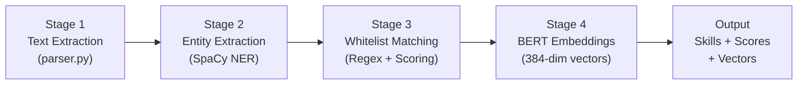
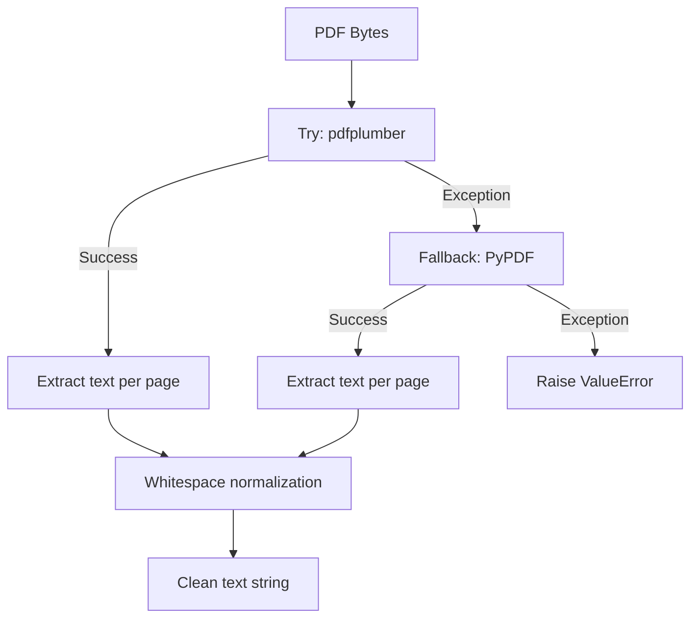
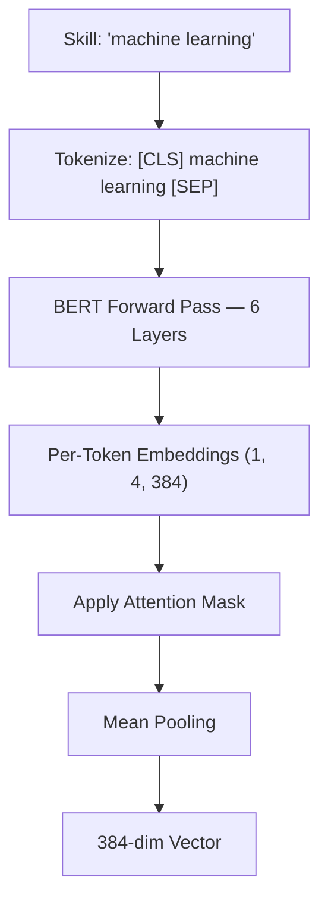
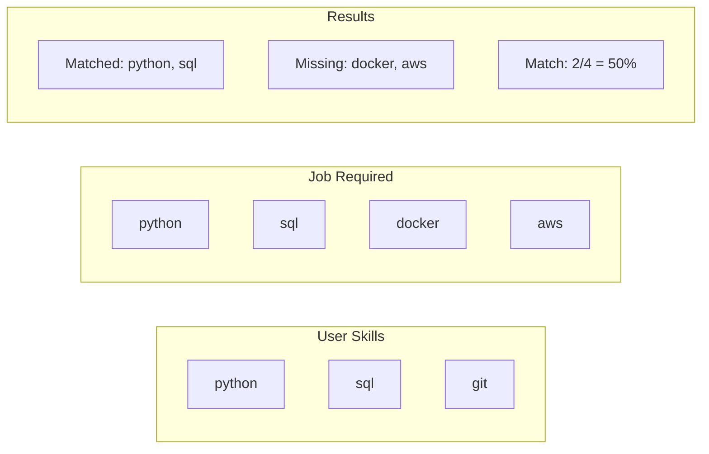
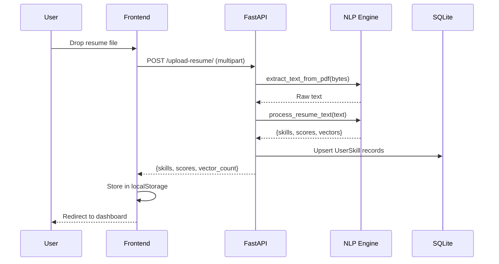

# Chapter 6: NLP Engine — Resume Processing Pipeline

---

## 6.1 Introduction

The NLP Engine is the intelligence core of the Smart Career Platform, responsible for transforming raw resume documents into structured, machine-readable skill profiles. It consists of three Python files: `parser.py` for text extraction, `skill_extractor.py` for skill identification and vectorization, and `gap_analyzer.py` for skill gap computation.

The pipeline processes resumes through four sequential stages:



**Figure 6.1: NLP Pipeline — Four Processing Stages**

---

## 6.2 PDF Text Extraction (parser.py)

The text extraction module implements a **dual-engine fallback strategy**. The primary engine is **pdfplumber**, chosen for its superior handling of tables, multi-column layouts, and spatial text positioning. If pdfplumber fails (due to corrupted metadata or unsupported encoding), the system automatically falls back to **PyPDF**, a simpler library with broader compatibility.

The `io.BytesIO()` wrapper converts raw bytes from the HTTP upload into a file-like object that both libraries can process, since PDF libraries expect objects with `.read()` and `.seek()` methods rather than raw byte arrays.

After extraction, **whitespace normalization** (`" ".join(text.split())`) collapses all whitespace sequences — spaces, tabs, newlines, carriage returns — into single spaces, producing clean, uniform text suitable for NLP processing downstream.



**Figure 6.2: PDF Extraction — Dual Engine Fallback**

For plain text files (`.txt`), UTF-8 decoding is attempted first, with Latin-1 (ISO-8859-1) as a safe fallback since it can decode any byte sequence without errors.

---

## 6.3 SpaCy NER-Based Entity Extraction

The `en_core_web_md` model (~40MB) provides tokenization, part-of-speech tagging, dependency parsing, Named Entity Recognition, and 300-dimensional GloVe word vectors. The entity extraction function processes resume text in two passes:

**Pass 1 — Noun Chunks:** SpaCy identifies "base noun phrases" (spans containing a head noun and modifiers, e.g., "machine learning algorithms", "Python programming"). Non-stop-word chunks longer than 2 characters are lemmatized and collected.

**Pass 2 — Named Entities:** The function filters entities by three labels most likely to contain technology terms:

| Label | Entity Type | Resume Examples |
|---|---|---|
| `ORG` | Organizations | "Google", "TensorFlow", "AWS" |
| `PRODUCT` | Products | "Docker", "React", "PostgreSQL" |
| `WORK_OF_ART` | Creative works | Project names, publications |

**Table 6.1: SpaCy Entity Labels Used for Extraction**

Results are deduplicated using Python's `set()` to eliminate redundant tokens. This stage produces a raw, noisy list that is subsequently refined by the whitelist matching stage.

---

## 6.4 Master Skill Whitelist Database

The platform maintains a curated whitelist of **87 skills** across 8 categories, stored as a Python set called `MASTER_SKILLS_DB`:

| Category | Count | Examples |
|---|---|---|
| Programming Languages | 12 | Python, Java, C++, JavaScript, Go, Rust, Swift |
| Web Frameworks | 11 | React, Next.js, Django, FastAPI, Spring, Angular |
| Databases | 8 | SQL, PostgreSQL, MongoDB, Redis, Cassandra |
| DevOps & Cloud | 11 | Docker, Kubernetes, AWS, Azure, Terraform |
| AI/ML | 14 | Machine Learning, TensorFlow, SpaCy, PyTorch |
| Frontend/Design | 10 | HTML, CSS, Tailwind, Bootstrap, Figma, UI/UX |
| Security | 4 | Cybersecurity, Penetration Testing, Cryptography |
| Soft Skills | 17 | Leadership, Communication, Agile, Project Management |
| **Total** | **87** | — |

**Table 6.2: Master Skill Whitelist — Category Distribution**

This whitelist serves as a precision filter — only skills appearing in this curated set are included in the final extraction results, eliminating false positives from the noisier SpaCy NER output.

---

## 6.5 Regex-Based Matching with Confidence Scoring

The `clean_extracted_skills()` function scans the raw resume text against every skill in the whitelist using custom regex patterns. Standard `\b` word boundaries fail for skills containing special characters (e.g., `c++`, `c#`, `node.js`, `ui/ux`), so the function uses **negative lookbehind/lookahead** patterns (`(?<![a-zA-Z0-9])skill(?![a-zA-Z0-9])`) to ensure accurate boundary detection.

For each detected skill, a **confidence score** is computed using the formula:

```
Score = min(98, 45 + (frequency × 12) + intrinsic_variance)
```

| Component | Range | Purpose |
|---|---|---|
| Base Score (45) | Fixed | Minimum confidence for any detected skill |
| Frequency Bonus (matches × 12) | 12-120+ | More mentions → higher confidence |
| Intrinsic Variance ((len×7 + char_sum) % 35) | 0-34 | Unique per-skill differentiation |
| Maximum Cap | ≤98 | Prevents unrealistic 100% scores |

**Table 6.3: Confidence Score Computation Parameters**

The `intrinsic_variance` component uses the skill string's length and character code sum to generate a deterministic but unique offset for each skill, ensuring that skills with equal frequency still display visually distinct scores on the dashboard charts.

---

## 6.6 BERT Contextual Embeddings

The platform uses the **`sentence-transformers/all-MiniLM-L6-v2`** model from HuggingFace, a lightweight BERT variant with 6 Transformer layers that generates 384-dimensional contextual embeddings. These vectors capture semantic meaning — "machine learning" and "deep learning" will have similar embeddings despite being different strings.

The embedding process uses **mean pooling with attention masking**: after the BERT forward pass produces per-token embeddings, the function masks out padding tokens (using the attention mask), sums the remaining embeddings along the token dimension, and divides by the count of non-padding tokens. This produces a single fixed-length vector regardless of skill name length.



**Figure 6.3: BERT Mean Pooling Process**

These embeddings enable downstream semantic similarity computations beyond simple string matching.

---

## 6.7 Master Orchestrator — process_resume_text()

The `process_resume_text()` function orchestrates the complete NLP pipeline. It accepts raw resume text and returns a comprehensive dictionary containing four outputs:

1. **`raw_extracted_skills`** — SpaCy NER output (noisy, unfiltered)
2. **`cleaned_skills`** — Whitelist-validated skill names (high precision)
3. **`skill_scores`** — Confidence scores per skill (dictionary mapping skill → score)
4. **`skill_vectors`** — BERT embeddings per skill (dictionary mapping skill → 384-dim numpy array)

The whitelist matching runs on the full raw text (not on the SpaCy output), so both extraction paths operate independently on the original resume content.

---

## 6.8 Skill Gap Analysis Module (gap_analyzer.py)

The `calculate_skill_gap()` function performs set-theoretic analysis between user skills and job requirements. Both skill lists are normalized to lowercase, then standard set operations compute the intersection (matched skills), difference (missing skills), and match percentage.



**Figure 6.4: Skill Gap — Set Theory Visualization**

The function returns matched skills, missing skills, the match percentage, and a prioritized learning list (top 10 missing skills).

---

## 6.9 Resume Upload Integration

The upload endpoint orchestrates the complete pipeline in a single request:



**Figure 6.5: Resume Upload — Complete Sequence**

For each detected skill, the endpoint checks if a `UserSkill` record already exists (upsert pattern). New skills are inserted; existing skills have their proficiency score updated. The raw score (0-100) is normalized to 0.0-1.0 before storage.

> **\[SCREENSHOT PLACEHOLDER: Resume upload page showing drag-and-drop interface with scanning animation\]**

---

## 6.10 Summary

This chapter covered the complete NLP Engine: dual-engine PDF extraction with fallback, SpaCy NER entity recognition, regex-based whitelist matching against 87 curated skills with confidence scoring, BERT contextual embedding generation, set-theoretic skill gap analysis, and the resume upload API integration.

---

\newpage

