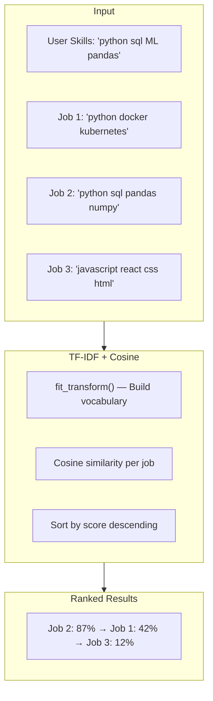
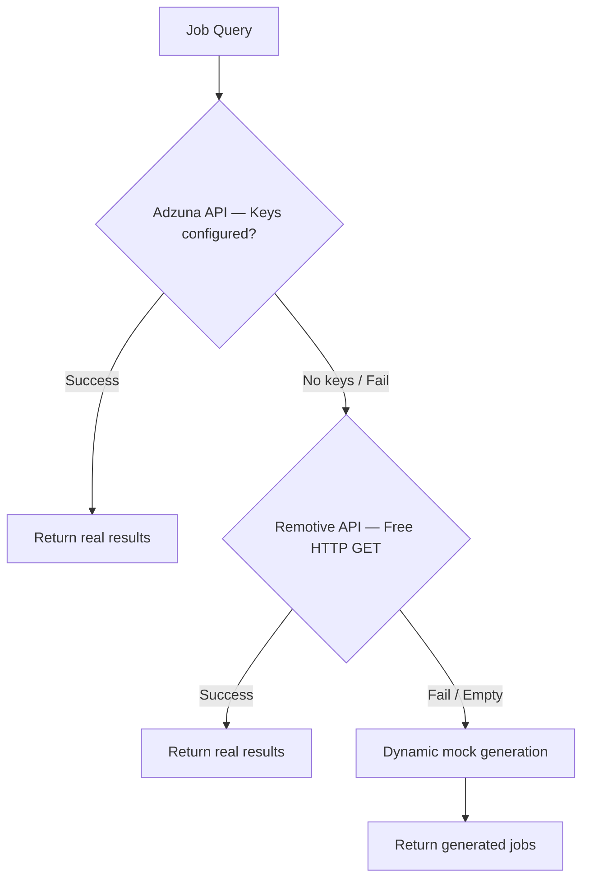
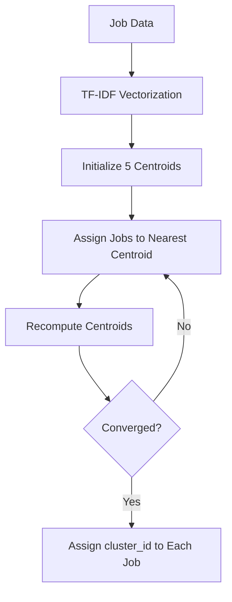
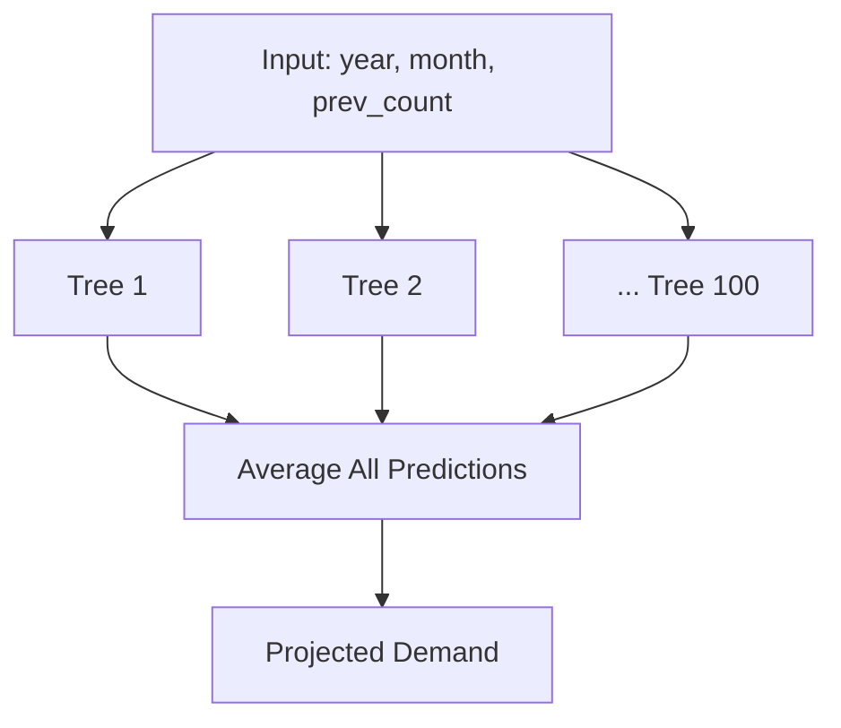
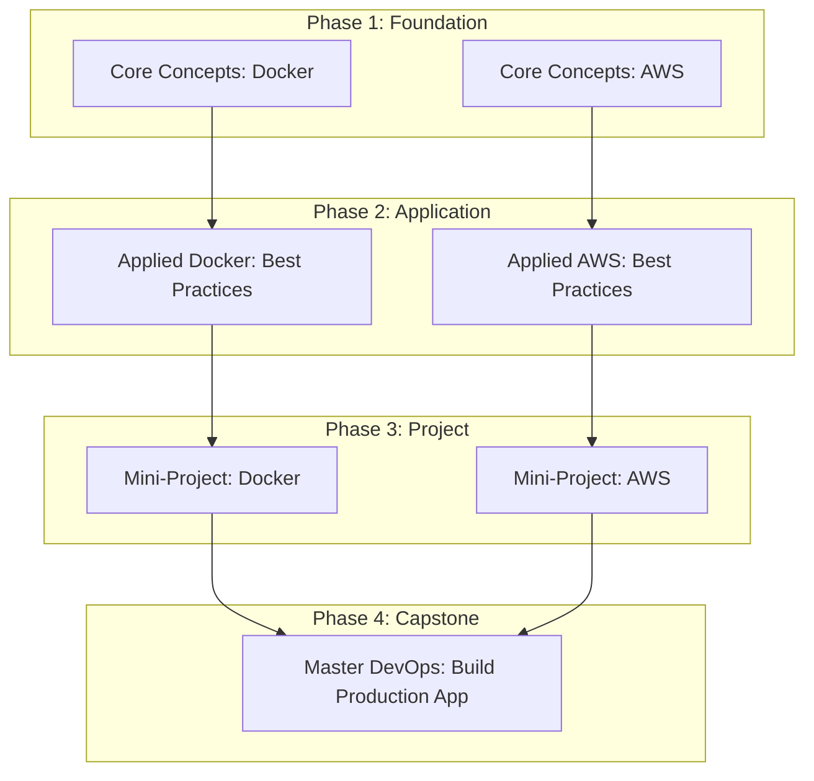

# Chapter 7: Machine Learning Models

---

## 7.1 Introduction

The Machine Learning layer powers the platform's intelligent recommendation and prediction capabilities through four modules: TF-IDF job matching (`matcher.py`), K-Means clustering (`clustering.py`), Random Forest demand forecasting (`predictor.py`), and personalized course recommendation (`content_recs.py`). Each module addresses a specific aspect of the career intelligence pipeline.

---

## 7.2 TF-IDF Vectorization for Job Matching (matcher.py)

### 7.2.1 Algorithm Overview

The job matching module uses **Term Frequency–Inverse Document Frequency (TF-IDF)** vectorization combined with **cosine similarity** to rank jobs by relevance to a user's skill profile. The algorithm treats both the user's skill set and each job's required skills as "documents," converts them into numerical vectors in a shared vocabulary space, and measures the angular distance between them.

**Mathematical Foundation:**

- **Term Frequency (TF):** `TF(t,d) = count(t in d) / total_terms(d)` — How often a term appears in a document, normalized by document length.
- **Inverse Document Frequency (IDF):** `IDF(t,D) = log((1+|D|) / (1+df(t))) + 1` — Penalizes common terms that appear in many documents, boosting rare, distinctive skills.
- **TF-IDF Score:** `TF-IDF(t,d,D) = TF(t,d) × IDF(t,D)` — The final weight for each term in each document.
- **Cosine Similarity:** `cos(θ) = (A·B) / (||A||×||B||)` — Measures alignment between two TF-IDF vectors, ranging from 0 (no overlap) to 1 (identical).

### 7.2.2 Process Flow

**Figure 7.1: TF-IDF Job Matching Process**

The function joins the user's skills into a single string, combines it with all job skill strings into a corpus, vectorizes the entire corpus using Scikit-Learn's `TfidfVectorizer` (with English stop words removed), computes cosine similarity between the user vector and each job vector, and returns the top N jobs sorted by match score.

---

## 7.3 Live Job Data Fetching Pipeline

### 7.3.1 Three-Tier Fallback Architecture

The platform retrieves real job listings through a robust three-tier fallback system designed to ensure data availability regardless of external API status:

**Priority 1 — Adzuna API:** A commercial job aggregator requiring API keys (app_id and app_key). When configured, it provides structured job data including title, company, location, salary range, and description. This is attempted first for the highest data quality.

**Priority 2 — Remotive API:** A free, public API (no API key required) specializing in remote job listings. The function sends an HTTP GET request with the job query as a search parameter and an 8-second timeout. Returns up to 8 jobs with title, company name, location requirements, description, and application URL.

**Priority 3 — Dynamic Fallback:** When both external APIs are unavailable, the system generates context-aware mock job data using the original search query to create realistic but synthetic listings. This ensures the platform always returns results.

**Figure 7.2: API Fallback Decision Tree**

### 7.3.2 Platform Link Generation

For each job, the system generates direct search URLs for five major job portals: **Indeed**, **LinkedIn**, **Google Jobs**, **Naukri**, and **Glassdoor**. All URLs include date-filtering parameters to show only recent postings (last 7 days for Indeed and LinkedIn), ensuring users see current opportunities rather than stale listings.

---

## 7.4 K-Means Clustering for Job Grouping (clustering.py)

The clustering module groups similar job roles into career families using the **K-Means algorithm**. Job titles and required skills are concatenated into a single string per job, then vectorized using TF-IDF. The K-Means algorithm iteratively assigns jobs to the nearest centroid and recomputes centroids until convergence.

| Parameter | Value | Rationale |
|---|---|---|
| `n_clusters` | 5 | Five career families (e.g., Data, Web, DevOps, etc.) |
| `random_state` | 42 | Ensures reproducible cluster assignments |
| `n_init` | 10 | Runs 10 initializations, picks best result |
| `max_df` | 0.8 | Ignores terms appearing in >80% of jobs (too common) |
| `min_df` | 2 | Ignores terms appearing in <2 jobs (too rare) |

**Table 7.1: K-Means Hyperparameters**

**Figure 7.3: K-Means Clustering Flow**

Once clustered, the `find_nearby_careers()` function returns all jobs in the user's matched cluster, enabling "similar roles you might like" recommendations.

---

## 7.5 Random Forest Demand Forecasting (predictor.py)

The demand forecasting module predicts future skill demand using a **Random Forest Regressor** — an ensemble of 100 decision trees, each trained on a bootstrapped sample of historical data. The final prediction is the average of all individual tree predictions, reducing variance and overfitting.

**Features used:** year, month, previous month's demand count.
**Target variable:** current month's demand count.

**Figure 7.4: Random Forest Ensemble Architecture**

The `forecast_skill_demand()` function projects demand over N years, applying a growth modifier to determine whether a skill is trending upward or declining. Results are displayed on the dashboard's line chart.

---

## 7.6 Personalized Course Recommendation (content_recs.py)

The course recommendation engine generates **multi-phase learning paths** for each missing skill identified by the gap analysis module. The four phases follow a progressive difficulty curve:

| Phase | Level | Content Type | Description |
|---|---|---|---|
| 1 | Beginner | Topic | Core concepts and fundamentals |
| 2 | Intermediate | Lab | Applied best practices and hands-on work |
| 3 | Advanced | Project | Mini-project implementation |
| 4 | Expert | Capstone | Production app integrating all skills |

**Table 7.2: Learning Path Phase Definitions**

**Figure 7.5: Multi-Phase Learning Path Structure**

Each phase includes a direct link to curated YouTube search results using URL-encoded skill names. The capstone phase (generated only when a target role is specified) integrates all missing skills into a single portfolio project.

---

## 7.7 Summary

This chapter covered the four ML modules: TF-IDF + cosine similarity for job matching, a three-tier live job API pipeline with fallback, K-Means clustering for career grouping, Random Forest regression for demand forecasting, and four-phase personalized learning path generation.

---

\newpage

